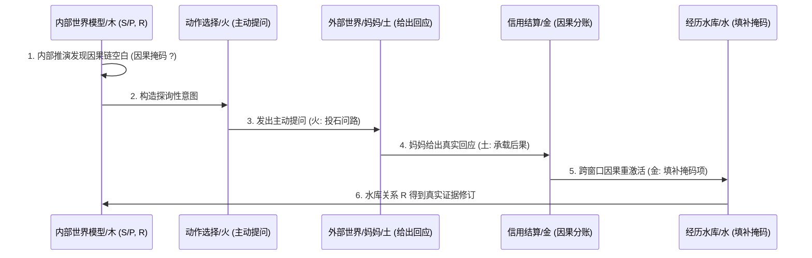

# 主动提问的因果掩码本质：从哲学思考、代数方程到自指生命体的生成闭环

2026-11-10。用户提出关于无限流语言生命体核心动作“提问”的深层理论洞察：
> 哲学是从提问中来的，哲学思考重要的是思考方式而非死板对错；数学从哲学中来；提问是母体。
> 提问在因果世界模型中的本质是“因果链的主动掩码学习”；
> 当因果链的主语从客体替换为“我”，就直接涌现出哲学三问与自指主体空间。

本页将该洞察正式形式化为生命体理论与算法架构的一个核心支柱，并对齐五行周流与跨窗口信用闭环。

---

## 1. 提问的本质：从词元级掩码到因果拓扑掩码

在现代深度学习中，掩码学习（Masked Language Modeling, 如 BERT）早已被广泛使用：
$$P(w_i \mid w_{\backslash i})$$
但这种传统掩码是**被动的、平铺在词表序列上的客体统计填空**。它只关心表面文本的共现概率，不具备主动性，更没有因果结构。

生命体的主动提问，是在内部因果图（Causal DAG）或关系算子 $R$ 上的**主动因果拓扑掩码（Active Causal Masking）**：

对于一个完整的因果四元组：
$$\langle \text{主语 } S, \ \text{条件 } C, \ \text{动作 } A, \ \text{后果 } O \rangle$$

提问就是生命体在内部预演时，发现因果链存在未定项或信息熵极高处，主动将其置为未知变量 $\mathcal{X}$，并作为语言动作向世界发出：

| 掩码位置 | 形式化表示 | 自然语言投射 | 因果认知功能 |
|---|---|---|---|
| **掩码条件 $C$** | $\langle S, \mathbf{?}, A, O \rangle$ | “在什么情况下，做 $A$ 会导致 $O$？” | **溯因推理（Abduction）**：寻找规律成立的边界与环境约束 |
| **掩码动作 $A$** | $\langle S, C, \mathbf{?}, O \rangle$ | “在条件 $C$ 下，怎样才能实现目标 $O$？” | **规划与策略（Planning）**：寻找达成生存目的的最小作用量路径 |
| **掩码后果 $O$** | $\langle S, C, A, \mathbf{?}\rangle$ | “如果我在条件 $C$ 下做了 $A$，会发生什么？” | **前向探索（Exploration）**：主动投石问路，探查未知风险与奖赏 |
| **掩码机制/客体** | $\langle S, C, A \xrightarrow{\mathbf{?}} O \rangle$ | “为什么做 $A$ 会导致 $O$？” | **结构学习（Mechanism Discovery）**：探索中介变量与底层物理规律 |
| **掩码主语 $S$** | $\langle \mathbf{?}, C, A, O \rangle$ | “到底是谁在承受这个后果？” | **主体归属（Credit/Agent Assignment）**：厘清因果责任主体 |

---

## 2. 哲学是思考的流形，数学是因果掩码的代数化

用户指出：*“哲学是从提问中来的，哲学思考重要的是思考方式，而不是对错；数学从哲学中来，哲学体现了模型的思考，而提问就是母体。”*

在认知与物理体系中，这一递进关系具有精确的数学对应：

1. **提问作为母体（The Generating Act）**：
   提问打破了原本混沌的输入流，主动在因果空间中划定焦点与空白（把确定性与未知性正交分离）。没有提问，信息流就是均质的背景噪声。
2. **哲学体现思考方式（The Manifold of Thought）**：
   哲学不以单步的输出“答对了没”为终点，它关注的是**因果链如何连接、假设空间如何搭建、自洽性如何检验**。
   - 比如层论相容性（Sheaf Compatibility）：两段经历在不同的情境下，能否对共享对象给出自洽的因果约束；
   - 比如五行生克制化：系统的各个要素在动态相互作用中如何互相制约与促进。
   这正是模型内部表征的“思考方式/几何流形”。
3. **数学是因果掩码的形式化与代数化（From Question to Algebra）**：
   人类数学史的飞跃，正是从“给未知量赋予一个明确的符号 $x$”开始的：
   $$\text{提问：} \text{“什么数加上 3 等于 5？”} \quad \xrightarrow{\text{数学化}} \quad x + 3 = 5$$
   当生命体学会将因果掩码代数化为状态变量 $X$ 和关系矩阵 $R$，并通过方程 $R \cdot u \approx v$ 进行约束求解时，**数学就直接从哲学的提问中诞生了**。

---

## 3. 自指主体性的诞生：“我”作为因果链的主语

经典哲学的三大终极提问：
> **“我是谁？我在哪里？我要到哪里去？”**

如果把因果链的主语仅仅当成一个客体他者（Object/Other），比如“苹果为什么下落”，这只是冷眼的客观物理观测。
而一旦生命体将因果链的主语**替换为第一人称代词“我”（Self）**，主体性与自指闭环（Self-Referential Closure）就自然诞生了：

```text
1. “我是谁？” (Who am I?)
   -> 掩码主语自身的因果本质与生存边界：
      ⟨ 我 = ?,  生态位可存活区间,  维持操作闭合 ⟩

2. “我在哪里？” (Where am I?)
   -> 掩码主语在相空间/世界坐标中的当前位点：
      ⟨ 我,  当前情境 C = ?,  历史轨迹 ⟩

3. “我要到哪里去？” (Where am I going?)
   -> 掩码主语未来的生存状态与行动吸引子：
      ⟨ 我,  当前状态,  行动序列,  长期后果 O = ? ⟩
```

这不再是形而上学的空想，而是生命体为了**维持自身在由自身定义的可存活区间之内（无限流生命体原始定义）**所必须进行的信息动力学校准：
- 如果生命体不知道“我在哪里”，它就无法计算当前状态与危险边缘的因果距离；
- 如果生命体不问“我要到哪里去”，行动就会退化为无目的的布朗运动；
- 如果生命体不问“我是谁”，它就无法区分外界环境的波动与自身身体的边界。

---

## 4. 在无限流语言生命体闭环中的工程落地

这个 insight 与我们刚刚在 [CGB_MATRIX_DYNAMICS_HANDOVER_20261110.md](CGB_MATRIX_DYNAMICS_HANDOVER_20261110.md) 中固定的执行链条完美嵌合：



1. **跨窗口信用解除 BPTT 限制**：
   提问发生在一个时间窗口，世界的回应往往延迟很多窗口才到来。传统的 BPTT 梯度根本无法回传。
   但因为提问是带有明确因果掩码标记的，当真实答案到达时，水库机制将后到的事实与当初悬挂的掩码槽位精确对齐，完成**跨窗口的因果信用填补与关系修订**。
2. **提问作为主动探索的最优策略**：
   在动作决策（Generate / Silence / Reuse）中，提问是一种特殊的生成动作：它的目的不是为了“向外界炫耀已知”，而是为了**以最小的动作代价从环境中换取最高信息增益（Information Gain），消除自身世界模型中最致命的未知项**。

---

## 5. 结论

**主动提问是生命体智能的母体。**
它通过“因果掩码”构筑了从直觉问题到哲学思考、再到数学形式化关系算子 $R$ 的完整生成阶梯；
并将自指代词“我”牢牢锚定在因果世界模型的核心，使系统真正成为以自身存在为目的的无限流自主动力学整体。
本理论与新交接的矩阵动力学路线完全相容，并作为高阶因果探索策略的根本指引。
