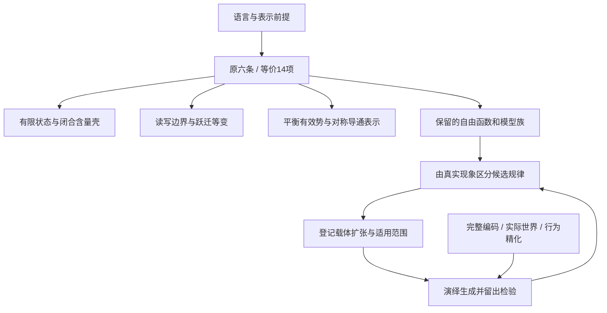

> **修订（2026-10-26）**：A04 接触齐性已从 P1b 删除（无用、起不到原定作用、迫使接触正则），见 [公理文档修订记录](CGB_AXIOMS_V0_20261022.md)。下文的 14 项现为 13 项（A04 空缺）。

# 同时审查最小性与生成后果（2026-10-23）

当前体系的作用是限定一类可能的物理过程。我们现在要问：哪些限制真是独立的，哪些只是表示方式；它们共同决定了什么，什么仍由自由选择决定。以下按实际 Lean 谓词整理，不按预想的大脑机制补公理。

本轮保留 `Medium`、`Life`、实际世界核与既有生成器；新增 `ConstraintAudit.lean`、`ConstraintFreedom.lean`，没有新物理条款、个体训练或脑能力实验。原六条复合谓词与下述14项的等价性已证。这14项是审查粒度，**不是已证明的最小公理集**；其中 P2c 的存在量词仍整体保留。

## 一、先把不同层次放回各自位置

| 层次 | 当前内容 | 审查问题 |
|---|---|---|
| 语言前提 | 有限位点；完整状态马尔可夫表示；固定接触/身份/边界；非负实数事件速率 | 换表示会改变哪些结论？局部状态是否藏了整张查找表？ |
| 一般候选约束 | P1a–P3 的14项子条件 | 在明确模型类中是否互推？共同强制哪些性质？ |
| 载体扩张 | 相遇统计、有向类型码、两态捕获等已登记候选 | 哪些自由函数被真实数据约束，适用范围是什么？ |
| 模型选择 | 具体几何、初态、世界、速率/作用函数与参数 | 是被推出、被测定，还是尚未决定？ |
| 目标性质 | 维持、非冻结记忆、预测、行动收益、自我模型、完整生命 | 是否存在满足者，在哪类世界中存在？不能把目标当物理前提 |
| 表示与证明工具 | 完整规则书编码、实际恢复、余代数比较与时钟证书 | 检查已有过程的描述/行为，不自动增加物理约束 |

“六条”是接口分组，“14项”是本次等价拆分；二者都不是最小性计数。语言中预置的有限性也须一起算，不能只数 `Axioms` 的字段。

## 二、14项统一清单

本轮用统一 `Holds` / `Isolates` 契约补齐全部14项证书：对每个目标项，明确要求其余13项同时成立而目标项失败。`all_atoms_independent` 将各见证打包为同一个全称命题。该结论针对固定14项在一般 `Medium` 语言中的相对不可删性；A01/A02在有限局部状态特化下仍自动成立。共同满足模型由 `twinFlip_all_conditions` 单独提供。

| ID／父条款 | 实际限制 | 完整单项反例证书 | 适用范围与剩余自由 |
|---|---|---|---|
| A01／P1a | 每个含量下层集有限 | `a01_independent`：`twinTape` | 一般类独立；见证局部状态无限。`Finite Λ` 下自动成立 |
| A02／P1a | 单元含量有统一上界 | `a02_independent`：`twinBag` | 一般类独立；见证局部状态无限。`Finite Λ` 下自动成立 |
| A03／P1a | 恰好一个零含量状态 | `a03_independent`：`twinBlank` | 其余13项均成立；唯一零含量态不自动等于能量基态 |
| A04／P1b | 接触关系顶点传递 | `a04_independent`：`path3Rigid` | 有限刚性接触载体反例；未据此判定实际连接组冲突，原A04保留 |
| A05／P1b | 事件参与者两两接触 | `a05_independent`：`globalFlip univ` | 跨不接触位点的正速率含量守恒对合；其余13项均成立 |
| A06／P1b | 只改写参与者 | `a06_independent`：`globalFlip ∅` | 空参与者却发生状态改写；其余13项均成立 |
| A07／P1b | 速率只读参与者状态与刺激 | `a07_independent`：`farFlip` | 局部证书补齐跨条款条件，保其余13项 |
| A08／P1b | 作用只读参与者状态与刺激 | `a08_independent`：`farAct` | 补证含量守恒、平衡、等变与P3，保其余13项 |
| A09／P2a | 正速率闭合事件守恒总含量 | `a09_independent`：`twinToggle` | 旧父条款见证经统一索引展开，保其余13项 |
| A10／P2b | calm下严格正详细平衡权重 | `a10_independent`：`twinCycle` | 旧父条款见证经统一索引展开，保其余13项 |
| A11／P2c | 同一事件置换同时保持速率与作用等变 | `a11_independent`：`triLookup` | 一般类独立；刚性体制下自动成立，原定义保留 |
| A12／P3 | 速率仅感知边界刺激 | `a12_independent`：`innerClock` | 补齐全部其余13项；全边界体制下仍自动成立 |
| A13／P3 | 作用仅感知边界刺激 | `a13_independent`：`innerActClock` | 补齐局部读写、守恒、平衡与等变，保其余13项 |
| A14／P3 | 初态保持结构自同构 | `a14_independent`：`pairPreset` | 一般类独立；刚性体制下自动成立，原定义保留 |

P2c 的正确量词为“每个结构对称存在一个事件置换，使速率和作用都等变”。若分别写两个存在量词，就可能允许它们使用不同置换，悄悄放松原理论。本轮等价拆分保留了这一关联。

## 三、现有条件合起来究竟产生了什么

### 1. 有限性可压成一个清楚的结构条件

`p1a_iff_finite_and_unique` 已证：

> P1a ⇔ 局部状态类型有限，而且恰好一个状态含量为零。

有限位点再给出全状态有限；闭合守恒进一步把闭合可达状态限制在含量壳内。这里 `content` 数值仍参与守恒，等价式不是“代价不再有用”。

同时 `arbitrarily_many_states_at_unit_capacity` 已证：任意 n 都有 n+1 个状态、唯一真空、全部状态含量≤1。所以当前形式化只得到**定性有限**，还没有“单位含量最多携带多少信息”的数值定律。若以后需要这个联系，应从物理/表示证据提出，而不是从当前谓词里读出来。

### 2. 等变性确实传到了实际跃迁，但约束力取决于结构

`jump_equivariant` 把事件级共同置换推到聚合跃迁核：同时搬动刺激、起态和终态，跃迁率不变。这是实际共同后果。

另一方面，`rigid_of_injective_identity`、`p2c_of_rigid` 和 `initial_invariant_of_rigid` 证明：身份全异足以让结构只剩恒等自同构，此时等变与初态不变性自动满足。接触齐性本身不能阻止这一情形。保留多少可交换结构，是具体模型的重要自由度，不是“写了对称就统一了全部规则”。

### 3. 边界限制有两端，二者共同解释约束何时起作用

- 全边界：仅边界感知自动成立；若每个事件都开放，闭合守恒也自动成立。
- 空边界：A12+A13让所有刺激都不可区分，再与平衡可逆结合，**每种刺激下都是同一可逆核**（`empty_boundary_every_stimulus_reversible`）。

因此边界不是只填一个比例就结束；它与参与者、世界响应和内部结构一起决定约束力。P3 提供接口限制，持续输入与有用交换还须由实际世界说明。

### 4. 详细平衡留下的不是几个参数，而是一整个对称函数

`fromConductance_reversible` 与 `reversible_conductance_representation` 给出双向表示：

\[
k(x,y)=\frac{C(x,y)}{\pi(x)},\qquad \pi(x)>0,\quad C(x,y)=C(y,x)\ge0.
\]

给定 π，详细平衡只固定正反速率比；任意非负对称导通量 C 都可以。它没有固定哪些边存在，也没有固定多快发生。π 本身也未被原公理选定，这个表示不声称唯一。

更强地，`rescale_axioms` 证明任意满足六条的介质，将全部速率乘 c≥0 仍满足六条；`rescale_jump` 表明实际核同步缩放，`rescale_changes_nonzero_jump` 确认有跃迁时 c=2 真改变核，c=0则冻结。固定世界时钟的准入条件会筛掉部分缩放，但它是另一个已明确登记的前提。

### 5. 六条核心允许非常广的受驱动过程

`arbitrary_driven_tables_admitted` 构造一整族模型：一个全边界位点，平衡刺激下冻结，另一恒定刺激下允许任意有限状态作用表与非负速率表；只需含量有唯一真空，即满足原六条。

`openSite_reproduces_process` 进一步证明：每个目标状态配一个事件，这一族可精确复现**任意有限马尔可夫跳变过程的非对角速率**，自跳与原 `Medium.jump` 一样不计。

这是约束许可范围的数学结果：把复杂过程塞进一个宏观局部状态类型，核心并不排除它。它**没有**满足完整规则书1%预算的证书，也不是生命存在或真实脑生成的见证。它暴露了状态粒度、边界分配、规则表复杂度仍有多大选择余地。已有 `RuleEncoding` 是约束描述规模的工具，但尚未证明将这些自由选择唯一缩成所需生成规律。

### 6. 驱动不能与时变协议混为一谈

现有 `seed_driven` 已在恒定 `food` 下不满足详细平衡；本轮 `constant_protocol_can_be_driven` 把恒定协议与该见证并列。因此时间齐次不等于平衡。主文档原来“驱动等于打破时间平移对称”的表述已修正，有效势也与物理储能、温度、功热账本分开。

## 四、尚未决定的自由度

| 自由数据 | 已受哪些限制 | 仍未选定 |
|---|---|---|
| 位点、状态、事件、刺激字母表 | 有限位点/事件语言，P1a推局部状态有限；具体层常另给有限刺激 | 尺度、粒度、状态语义、事件目录；单元是否偷藏全局表 |
| `near`、`ident`、`boundary` | 接触齐性；结构自同构决定等变关系 | 几何/距离、身份复用、边界布局、实际非平凡对称 |
| `content` | 唯一零、定性有限、闭合事件总和守恒 | 具体数值、信息量与物料/能量/硬件的对应 |
| `parts` | 两两接触；读写局部 | 大小、事件分解、是否只有极少闭合事件 |
| `act` | 局部读写、结构等变、仅边界感知、闭合守恒 | 结构生成/回收和状态变化的具体法则 |
| `rate` | 非负、读域、等变、边界感知；calm下详细平衡 | π、C、驱动态耦合、零率、快慢尺度、正则性 |
| `init`、`calm` | 出生态不变；指定calm核可逆 | 出生准备过程、为什么该刺激代表物理平衡 |
| `World.stimulus`、`World.moves`、时钟 | 联合过程、边界读取、实际恢复等分别有显式前提 | 世界资源、丰富度、驱动来源、反馈、可靠性及可比物理时间 |
| 编码与观测 | 固定规则书解释器、全数据预算；精化须保持所登记观察 | 共享生成程序、真实编码长度、哪些观测充分代表目标 |

这些自由度不全是缺陷。几何、初态和环境原本就应能变化，才能让同一规律生成不同脑。现在要区分：哪些是希望保留的模型自由，哪些是应由真实规律限制的任意性，哪些只是表示选择。最小性是相对于固定语言和模型类的；改变表示后的“更短公理”还须核算被藏进语言的代价。



## 五、接下来沿什么问题展开

`SubconditionGraph.lean` 提供条件冗余、局部解耦与候选桥接；`AtomicIndependence.lean` 现补齐14项完整单项反例。九字段子集继续命名为 `ReducedCore`。新增 `every_reduced_condition_independent_in_regime` 为其中每一项提供有限局部状态、接触齐性、结构刚性的反例，且仍满足其余13项，确立该固定约简集在所声明体制内逐项不可删除。精确桥接保持为：

```text
Finite Λ + HomogeneousContact + Rigid ⊢ (ReducedCore ↔ Atomized)
```

其中 `HomogeneousContact` 就是 A04，恢复定理将它作为额外假设重新加入。`finite_rigid_reducedCore_not_atomized` 已构造有限、刚性、满足约简集却不满足原14项的模型，确认遗漏A04会破坏等价。原 `Medium.Axioms` 和 `Atomized` 的定义保持不变。

`near` 表示位点允许共同参与事件的接触关系；真实连接组是另一个待映射的对象。三节点非齐性定理可用于审查某种载体选择，尚不足以判定果蝇实现与现有接触公理冲突。唯一零含量态也不自动是最低能量态。


逐项证书现已补齐；下一步核对具体载体的 `near`、参与者、身份与边界如何对应物理对象，明确固定接触载体和生成接线的映射。九项不可删是相对于这组谓词及已声明体制的结论；若改变语言、合并条款或改变目标，须重新登记依赖，不能把列表计数当作普遍物理定律数量。

同时沿本轮暴露的核心空位前进：**在保持边界、身份、初态可以变化的前提下，真实数据是否把自由的作用与导通函数限制成少数共享的生成规律？** 已有相遇、有向匹配、捕获与营养成果在这里接续。每条候选先声明限制了哪个自由函数、适用哪个载体，再从该限制演绎后果、回到真实果蝇检验；不预先要求它必须产出某个手工机制。

生命存在性继续作为独立目标：删约束扩大模型类，原有见证仍被允许。因此坏模型不能证明某公理对“存在一个生命”必要；它可以证明某组条件不足以**保证所有成员**具有某性质。最小性、共同后果、模型许可范围与生命存在四栏分别记账。

本次交付的是固定子条件列表的完整相对独立性证书与同体制约简证明。独立性检验解决了“是否被其余条款推出”；具体生成规律仍由已登记的物理对应、扩张规律与数据检验约束，生命存在性继续独立构造见证。

## 六、证据入口与回退

- 原定义：`lean/CGBAxioms/CGBAxioms/Medium.lean`；历史反例：`Models.lean`，两者本轮未改。
- 新证明：`ConstraintAudit.lean`、`ConstraintFreedom.lean`；等价分解入口 `CGB.Medium.axioms_iff_atomized`。
- 主文档：`CGB_AXIOMS_V0_20261022.md` v0.11；新增子条件与条件约简证明：`SubconditionGraph.lean`。
- 机器可读结果和逐项证明引用：`results/published/cgb_minimality_generativity_20261023.json`。
- 全量信任/模块审计、旧43项、源码哈希、归档副本检查与增量Git备份：`F:/fly_stream_overflow/cgb_minimality_generativity_20261023/`。
- 本轮父提交 `25b1b5fb6f9d697101be7095ca467b840e5c2244`。归档检查验证形式推导和来源，不等同于独立科学复核或真实果蝇验证。

- Gemini增量的结论复核及修正：`CGB_GEMINI_REVIEW_20261023.md`；更正后的发布记录：`results/published/cgb_hilbert_purification_20261023.json`。历史v0.9结果文件保留原始证据含义。

- 全部逐项证书、同体制约简与本轮审计：`AtomicIndependence.lean`、`CGB_ATOMIC_INDEPENDENCE_20261023.md`、`results/published/cgb_atomic_independence_20261023.json`。先前复核报告保留当时审查状态。
