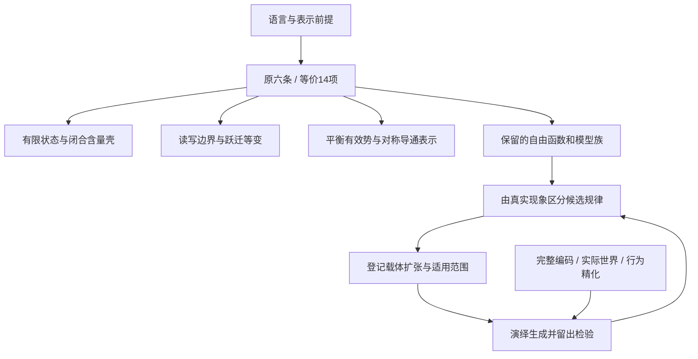

# 同时审查最小性与生成后果（2026-10-23）

当前体系的作用是限定一类可能的物理过程。我们现在要问：哪些限制真是独立的，哪些只是表示方式；它们共同决定了什么，什么仍由自由选择决定。以下按实际 Lean 谓词整理，不按预想的大脑机制补公理。

本轮保留 `Medium`、`Life`、实际世界核与既有生成器；新增 `ConstraintAudit.lean`、`ConstraintFreedom.lean`，没有新物理条款、个体训练或脑能力实验。原六条复合谓词与下述14项的等价性已证。这14项是审查粒度，**不是已证明的最小公理集**；其中 P2c 的存在量词仍整体保留。

## 一、先把不同层次放回各自位置

| 层次 | 当前内容 | 审查问题 |
|---|---|---|
| 语言前提 | 有限位点；完整状态马尔可夫表示；固定接触/身份/边界；非负实数事件速率 | 换表示会改变哪些结论？局部状态是否藏了整张查找表？ |
| 一般候选约束 | P1a–P3 的14项子条件 | 在明确模型类中是否互推？共同强制哪些性质？ |
| 载体扩张 | 相遇统计、有向类型码、两态捕获等已登记候选 | 哪些自由函数被真实数据约束，适用范围是什么？ |
| 模型选择 | 具体几何、初态、世界、速率/作用函数与参数 | 是被推出、被测定，还是尚未决定？ |
| 目标性质 | 维持、非冻结记忆、预测、行动收益、自我模型、完整生命 | 是否存在满足者，在哪类世界中存在？不能把目标当物理前提 |
| 表示与证明工具 | 完整规则书编码、实际恢复、余代数比较与时钟证书 | 检查已有过程的描述/行为，不自动增加物理约束 |

“六条”是接口分组，“14项”是本次等价拆分；二者都不是最小性计数。语言中预置的有限性也须一起算，不能只数 `Axioms` 的字段。

## 二、14项统一清单

表中“未独立审结”表示尚无逐项、保留其余13项的完整核验证书；不是判定该项冗余。旧反例定位复合条款，不能自动覆盖它的所有内部条件。

| ID／父条款 | 实际限制 | 已有后果或证据 | 冗余、空转及剩余自由 |
|---|---|---|---|
| A01／P1a | 每个含量下层集有限 | 一般类有 `twinTape_witness`；与A02共同推出局部状态有限 | 有限 Λ 中自动成立；一般类的独立性和有限特化的冗余须分开 |
| A02／P1a | 单元含量有统一上界 | 一般类有 `twinBag_witness`；与A01共同推出局部状态有限 | 有限 Λ 中自动成立；未指定容量数值与状态数的定量关系 |
| A03／P1a | 恰好一个零含量状态 | `twinBlank_witness`；有限特化中是P1a仅存条件 | 真空之外的数值代价仍自由；它还进入P2a，不能从整个理论删除 `content` |
| A04／P1b | 接触关系的自同构可把任意位点移到任意位点 | 接触齐性明确登记 | 完整图也满足；不保证加入身份/边界后仍有非平凡对称。未独立审结 |
| A05／P1b | 每个事件的参与者两两接触 | 限定合法作用域 | 未限制距离、度数、参与者数量；没有自动得到双体机制。未独立审结 |
| A06／P1b | 事件不改参与者之外的状态 | 已证参与者为空时作用为恒等 | 参与者可覆盖全体；这种情况下写局部约束自动满足。未独立审结 |
| A07／P1b | 速率只读参与者的状态和刺激 | 旧 `farFlip_witness` 定位P1b读域问题 | 参与者全体时读域不排除全局表；未交付保留其余13项的独立证书 |
| A08／P1b | 参与者内作用只读参与者的状态和刺激 | 与A06合起来限制完整作用 | 作用函数的形式仍自由；未独立审结 |
| A09／P2a | 正速率闭合事件守恒总含量 | 旧 `twinToggle_witness`；闭合可达状态限于含量壳 | 所有事件都触边界时自动成立；实际资源库和开放交换账本仍自由 |
| A10／P2b | `calm` 下聚合核有严格正的详细平衡权重 | 旧 `twinCycle_witness`；有效势及导通量参数化 | 允许零核、断开的支持和任意时间尺度；不决定混合、周转或物理功热 |
| A11／P2c | 对每个结构对称，**同一事件置换**同时保持速率和作用等变 | 旧 `triLookup_witness`；本轮证聚合核等变 | 结构刚性时自动成立；不单独保证有限程序/低秩。未将共同存在量词拆成两个不同证书 |
| A12／P3 | 速率只感知边界刺激 | 旧 `innerClock_witness` 定位边界感知问题 | 全体位点均为边界时自动成立；与A13的逐项独立性未审结 |
| A13／P3 | 作用只感知边界刺激 | 与A12使同边界刺激给出同一聚合核 | 全边界时自动成立；未独立审结 |
| A14／P3 | 初态保持结构自同构 | 旧 `pairPreset_witness` 定位初态对称问题 | 结构刚性时自动成立；仅限制对称轨道，不选定具体初态 |

P2c 的正确量词为“每个结构对称存在一个事件置换，使速率和作用都等变”。若分别写两个存在量词，就可能允许它们使用不同置换，悄悄放松原理论。本轮等价拆分保留了这一关联。

## 三、现有条件合起来究竟产生了什么

### 1. 有限性可压成一个清楚的结构条件

`p1a_iff_finite_and_unique` 已证：

> P1a ⇔ 局部状态类型有限，而且恰好一个状态含量为零。

有限位点再给出全状态有限；闭合守恒进一步把闭合可达状态限制在含量壳内。这里 `content` 数值仍参与守恒，等价式不是“代价不再有用”。

同时 `arbitrarily_many_states_at_unit_capacity` 已证：任意 n 都有 n+1 个状态、唯一真空、全部状态含量≤1。所以当前形式化只得到**定性有限**，还没有“单位含量最多携带多少信息”的数值定律。若以后需要这个联系，应从物理/表示证据提出，而不是从当前谓词里读出来。

### 2. 等变性确实传到了实际跃迁，但约束力取决于结构

`jump_equivariant` 把事件级共同置换推到聚合跃迁核：同时搬动刺激、起态和终态，跃迁率不变。这是实际共同后果。

另一方面，`rigid_of_injective_identity`、`p2c_of_rigid` 和 `initial_invariant_of_rigid` 证明：身份全异足以让结构只剩恒等自同构，此时等变与初态不变性自动满足。接触齐性本身不能阻止这一情形。保留多少可交换结构，是具体模型的重要自由度，不是“写了对称就统一了全部规则”。

### 3. 边界限制有两端，二者共同解释约束何时起作用

- 全边界：仅边界感知自动成立；若每个事件都开放，闭合守恒也自动成立。
- 空边界：A12+A13让所有刺激都不可区分，再与平衡可逆结合，**每种刺激下都是同一可逆核**（`empty_boundary_every_stimulus_reversible`）。

因此边界不是只填一个比例就结束；它与参与者、世界响应和内部结构一起决定约束力。P3 提供接口限制，持续输入与有用交换还须由实际世界说明。

### 4. 详细平衡留下的不是几个参数，而是一整个对称函数

`fromConductance_reversible` 与 `reversible_conductance_representation` 给出双向表示：

\[
k(x,y)=\frac{C(x,y)}{\pi(x)},\qquad \pi(x)>0,\quad C(x,y)=C(y,x)\ge0.
\]

给定 π，详细平衡只固定正反速率比；任意非负对称导通量 C 都可以。它没有固定哪些边存在，也没有固定多快发生。π 本身也未被原公理选定，这个表示不声称唯一。

更强地，`rescale_axioms` 证明任意满足六条的介质，将全部速率乘 c≥0 仍满足六条；`rescale_jump` 表明实际核同步缩放，`rescale_changes_nonzero_jump` 确认有跃迁时 c=2 真改变核，c=0则冻结。固定世界时钟的准入条件会筛掉部分缩放，但它是另一个已明确登记的前提。

### 5. 六条核心允许非常广的受驱动过程

`arbitrary_driven_tables_admitted` 构造一整族模型：一个全边界位点，平衡刺激下冻结，另一恒定刺激下允许任意有限状态作用表与非负速率表；只需含量有唯一真空，即满足原六条。

`openSite_reproduces_process` 进一步证明：每个目标状态配一个事件，这一族可精确复现**任意有限马尔可夫跳变过程的非对角速率**，自跳与原 `Medium.jump` 一样不计。

这是约束许可范围的数学结果：把复杂过程塞进一个宏观局部状态类型，核心并不排除它。它**没有**满足完整规则书1%预算的证书，也不是生命存在或真实脑生成的见证。它暴露了状态粒度、边界分配、规则表复杂度仍有多大选择余地。已有 `RuleEncoding` 是约束描述规模的工具，但尚未证明将这些自由选择唯一缩成所需生成规律。

### 6. 驱动不能与时变协议混为一谈

现有 `seed_driven` 已在恒定 `food` 下不满足详细平衡；本轮 `constant_protocol_can_be_driven` 把恒定协议与该见证并列。因此时间齐次不等于平衡。主文档原来“驱动等于打破时间平移对称”的表述已修正，有效势也与物理储能、温度、功热账本分开。

## 四、尚未决定的自由度

| 自由数据 | 已受哪些限制 | 仍未选定 |
|---|---|---|
| 位点、状态、事件、刺激字母表 | 有限位点/事件语言，P1a推局部状态有限；具体层常另给有限刺激 | 尺度、粒度、状态语义、事件目录；单元是否偷藏全局表 |
| `near`、`ident`、`boundary` | 接触齐性；结构自同构决定等变关系 | 几何/距离、身份复用、边界布局、实际非平凡对称 |
| `content` | 唯一零、定性有限、闭合事件总和守恒 | 具体数值、信息量与物料/能量/硬件的对应 |
| `parts` | 两两接触；读写局部 | 大小、事件分解、是否只有极少闭合事件 |
| `act` | 局部读写、结构等变、仅边界感知、闭合守恒 | 结构生成/回收和状态变化的具体法则 |
| `rate` | 非负、读域、等变、边界感知；calm下详细平衡 | π、C、驱动态耦合、零率、快慢尺度、正则性 |
| `init`、`calm` | 出生态不变；指定calm核可逆 | 出生准备过程、为什么该刺激代表物理平衡 |
| `World.stimulus`、`World.moves`、时钟 | 联合过程、边界读取、实际恢复等分别有显式前提 | 世界资源、丰富度、驱动来源、反馈、可靠性及可比物理时间 |
| 编码与观测 | 固定规则书解释器、全数据预算；精化须保持所登记观察 | 共享生成程序、真实编码长度、哪些观测充分代表目标 |

这些自由度不全是缺陷。几何、初态和环境原本就应能变化，才能让同一规律生成不同脑。现在要区分：哪些是希望保留的模型自由，哪些是应由真实规律限制的任意性，哪些只是表示选择。最小性是相对于固定语言和模型类的；改变表示后的“更短公理”还须核算被藏进语言的代价。

## 五、接下来沿什么问题展开

先对读域、写域、接触齐性和P3内部条件补逐项依赖证书，使用已有反例或证明它们在所声明子类中可互推；结论可以是保留、合并或条件删除。不得把只打破父条款的旧见证直接当成14项全部独立。

同时沿本轮暴露的核心空位前进：**在保持边界、身份、初态可以变化的前提下，真实数据是否把自由的作用与导通函数限制成少数共享的生成规律？** 已有相遇、有向匹配、捕获与营养成果在这里接续。每条候选先声明限制了哪个自由函数、适用哪个载体，再从该限制演绎后果、回到真实果蝇检验；不预先要求它必须产出某个手工机制。

生命存在性继续作为独立目标：删约束扩大模型类，原有见证仍被允许。因此坏模型不能证明某公理对“存在一个生命”必要；它可以证明某组条件不足以**保证所有成员**具有某性质。最小性、共同后果、模型许可范围与生命存在四栏分别记账。

本次交付的是一次有证明的依赖与自由度整理。逐项独立性尚未全部结束，完整生成规律也尚未由核心唯一确定；现在可以根据明确空位继续发现，而不再用“公理已齐”和“机制待补”两句话掩盖其中的选择。

## 六、证据入口与回退

- 原定义：`lean/CGBAxioms/CGBAxioms/Medium.lean`；历史反例：`Models.lean`，两者本轮未改。
- 新证明：`ConstraintAudit.lean`、`ConstraintFreedom.lean`；等价分解入口 `CGB.Medium.axioms_iff_atomized`。
- 主文档：`CGB_AXIOMS_V0_20261022.md` v0.9，已同步修正旧表述，不只追加免责声明。
- 机器可读结果和逐项证明引用：`results/published/cgb_minimality_generativity_20261023.json`。
- 全量信任/模块审计、旧43项、源码哈希、归档副本检查与增量Git备份：`F:/fly_stream_overflow/cgb_minimality_generativity_20261023/`。
- 本轮父提交 `25b1b5fb6f9d697101be7095ca467b840e5c2244`。归档检查验证形式推导和来源，不等同于独立科学复核或真实果蝇验证。
