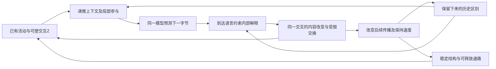

# 定理的相容核心：全部 1768 条遍历后的约束与做法（2026-11-03）

**最新运行结论（2026-11-03）：**§9的反馈接入已完成真实语言验证；三种子OWT未显示净收益，长窗口增加了历史使用，反馈也确实被使用。其条件性锁存/势函数证明保留，不推出一般语言理解收益。当前验收已有GDN+有限快表的独立语言收益、完整恢复及资源成本，再接行动后果；不再默认先补前向信用。执行顺序与证据见[Claude交接](CGB_CLAUDE_HANDOFF_20261103.md)，本更新优先于下文历史阶段的“尚未接入/下一步”。

> 后续复核：[N 类用途审查](CGB_THEOREM_N_REVIEW_20261103.md)。本文保留原遍历与综合过程；第 3 节是相容集合构造搜索的起点，尚未证明联合非空、最大或唯一。保留两相、谱系、收缩、共享势等前提，可以把这些机制作为本候选的强约束；不必证明所有身体都必须如此才采用。N 表示未列入原 R/M/W，不表示无参考价值。

**当前施工入口为第8–9节。**第8节统一条件，第9节将其中一段代入实际神经递推。前面的候选和局部联合构造保留为材料；其前提尚未由同一个语言身体共同产生，不能视为已经完成的最大覆盖、最小生成元。

## 1. 怎么做的

六个子代理分组逐条读完 `CGB_THEOREMS/production/` 的 133 个模块，每条都读了解释、源码说明和形式陈述，不看原分类标签，按同一标准判定。记录在 `results/cgb_theorem_traversal_20261103/traverse_out_0..5.jsonl`，名称与文档标题逐条核对，1768 条无缺无重。

| 判定 | 条数 | 含义 |
|---|---:|---|
| R | 169 | 对身体的要求：做不到就不行 |
| M | 174 | 做法：某个局部机制能达到所需性质 |
| W | 22 | 世界前提 |
| N | 1403 | 玩具世界见证、记账、辅助引理、旁支、重复 |

169 条 R 里有 119 条原来被标成设计、见证或语义，所以旧门一条都没收。我对照源码抽查了 8 条关键改判（`outcome_blind_drift_zero`、`two_phase_drift`、`positive_soft_query_changes_under_delta`、`shared_potential_forces_nesting`、`vanishing_gain_loses_under_drift`、`stopped_teaching_complete_iff`、`equilibrium_memory_bound`、`no_global_gain_for_heterogeneous_compartments`），陈述与前提都与判定一致。其余判定是子代理的，未逐条复核。

## 2. 前提之间的冲突与化解

已证定理在公理下同时成立，不会互斥。会互斥的是设计和前提。下表每一行是一组冲突，以及定理自己给出的出路。

| # | 冲突 | 化解 | 依据 |
|---|---|---|---|
| C1 | 平静时要细致平衡（P2b），平衡态记忆按 1/T 衰减、没有双峰点燃、Hill 系数为 1；但长期记忆、锁存、高增益开关都要更多 | 静默时的记忆放在守恒可观测量或多量子协同态上，二者在平衡下就成立；非平衡只能从边界的字节流进来 | `equilibrium_memory_bound`、`no_valley`、`equilibrium_hill_one` 对 `remembers_of_conserved_observable`、`quanta_hill`、`interior_detailed_balance` |
| C2 | 精度累积使增益按 1/n 自动衰减；世界漂移时增益不能趋零 | 每次观测前加过程方差，增益有正下界；稀有特征按自己的出现时钟计 | `repeated_assimilation_retention` 对 `vanishing_gain_loses_under_drift`；`process_noise_gain_floor`、`occurrence_clock_beats_time_clock` |
| C3 | 纯乘性再投资是贝叶斯混合，但地址归零不回来、集中后出不去 | 输运下限 ε 给恢复；同一均匀混合也压缩标签区别。几何时间常数银行是有限延迟带上的一个充分构造，非唯一必选结构 | `extinct_stays_extinct`、`concentrated_absorbing` 对 `recovers_from_floor`；`bracket_after`、`geometric_bank_covers` |
| C4 | 软地址（严格正的 softmax 权重）读写方便，但任一次写入都扰动所有读出 | 若要求旧读出严格不变，需要零重叠或其他抵消；允许近似保留时应控制误差，不必强制稀疏。固定稀疏支撑是可选构造 | `positive_soft_query_changes_under_delta`、`tied_write_cross_read` 对 `log_softmax_direction_deriv` |
| C5 | 线性门控 delta 记忆高效，但会收缩、不能锁存、静默中衰减为零、对内容可加、突发损伤消不掉 | 非线性来自地址：键由一个到达给、查询由另一个到达给；一个整流单元读一个交互；避免对承担锁存的完整状态强加严格收缩；是否分隔室由共同构造决定 | `gated_delta_contracts`、`silent_rest_unique`、`association_read_additive_in_contents`、`linear_burst_damage_integral` 对 `key_query_read_interacts`、`one_rectifier_reads_interaction`、`contraction_has_no_two_latches` |
| C6 | 共享有限池的边际准入在局部就反垄断，但只有一个共享势时，强连接必然长成富人俱乐部 | 每个隔室有自己的局部势和池，行列两侧都有预算 | `shared_pool_marginal_admission_is_anti_dominant` 对 `shared_potential_forces_nesting`；`column_budget_allows_wta`、`row_budget_allows_copies`、`doubly_budgeted_max_differentiates` |
| C7 | 一个全局学习率简单，但各隔室或通路的波动和信噪比不同 | 异质估计条件要求局部适配；Kalman形式是一种带噪声模型前提的构造。局部反优势结论还要求局部需求可读 | `no_global_gain_for_heterogeneous_compartments`、`no_shared_shrink_for_two_snr`、`local_anti_dominance_requires_demand_readout` 对 `fixed_gain_error`、`reservoir_availability_is_local_anti_dominant` |
| C8 | 有限容量下摄入不停，排出就不能停；但不看内容的排出最终遗忘一切 | 持续保留下界排除统一正删除率；现有定理结论是无统一正下界，不直接写成极限趋零。年龄巩固与短突发拒绝是可选构造，须另接释放 | `export_forced`、`unselective_export_forgets` 对 `retention_needs_selectivity`、`held_budget_starves`、`release_threshold_monotone_in_age`、`deferLatch_*` |
| C9 | 局部一步信用是精确的，但教学系数本身随参数变化时，停梯度的局部更新就不再是真梯度；单相局部规则也不是梯度 | 三因子：前 × 后（由前向响应门控）× 边界送来、减了基线的结果新息；在该两项漂移模型中，普遍梯度对齐要求观察项与预测项权重相等；预测项可解析计算，不强制另建睡眠模块；延迟信用用前向标签，或在后来重新读出时再测一次 | `stopped_teaching_complete_iff`、`phases_must_balance`、`outcome_blind_drift_zero`、`contact_response_saturated_increment_zero` 对 `reciprocal_contact_teaching_deriv`、`two_phase_drift`、`centered_bernoulli_evidence_zero_mean`、`tag_is_exact_credit` |
| C10 | 对称出生、对称驱动的单元永不分化；结构化连接需要身份页 | 一分为二的分裂同时给出身份码和嵌套隔室（谱系码是超度量） | `symmetric_stays_symmetric`、`xhop_pages` 对 `sharedPrefix_ultrametric`、`exists_tree_of_clog_depth` |
| C11 | 平衡单元最多读两个独立部分；读出却常常要汇总很多部分 | 二分汇聚树，深度不少于 ⌈log₂k⌉ | `three_part_balance_impossible` 对 `two_part_balance`、`clog_leaves_le_depth` |
| C12 | 写地址不看上下文时语序丢失；连接两端只看当前符号时，长出的结构只反映字频 | 写入按上下文选址；连接两端保留过去输入 | `assimilate_order_blind`、`memoryless_same_frequencies_same_structure` 对 `cell_mean_is_conditional_statistic` |
| C13 | 用产生写入的那些字节评判写入，结果偏乐观 | 只用之后没见过的字节评判 | `in_sample_decrease_bias_mean`、`precision_binary_sample_gain_not_future_guarantee` 对 `fresh_decrease_unbiased` |

静默问题需区分：稳态有向环流、内部可逆跳转、非平衡初态松弛不是同一件事。`driven_cycle_not_balanced`针对细致平衡与有向环流的冲突，不能推出所有静默内部活动都不可能；第6.1节的同体记忆见证已允许非平凡静默事件。语言思考的实际动力学仍待共同构造。

## 3. 候选组合：尚未证明联合可实现的身体家族

下面是把上表各行局部可行路径合起来的人工综合。尚未证明这些前提能在同一状态与转移上同时成立，也未证明组合非空、最大或唯一；不能据此把九条实现选择逐项设为所有身体的硬要求。

用户 2026-11-03 明确：当前任务正是继续扩大和实现这个相容集合，而不是退回只保留普遍必要条件。九条中的有条件构造不能因“不适用于所有身体”被搁置；要把条件一起纳入当前设计，再寻找同时承载它们的少量生成律。最大覆盖不是定理条数最多，而是独立且相关的约束充分交叠；已有蕴含关系需要合并，不能靠重复计数制造进展。

1. **介质**：成对反应表，速率按 `κ·exp(−ΔE/2)` 写，正反电导相等，P2b 自动成立；可塑性只改 κ。
2. **生长**：从一个单元一分为二地长；谱系码给每个单元身份，同时给出嵌套隔室；读出走二分汇聚树。
3. **隔室**：每个隔室有自己的局部势和资源池，行列两侧都有预算；增益按隔室和通路局部化，取精度加权形式，并有过程方差下限；稀有通路用自己的出现时钟。
4. **地址与写入**：写入按上下文选址，地址稀疏或带符号；值按精度加权（Kalman 新息）写入。
5. **非线性**：键和查询来自不同到达；整流单元读交互；锁存是多量子协同单元或守恒可观测量，放在与地址不同的隔室里，必须保留通向摄入的出口，并且对线索敏感。
6. **记忆的保留与释放**：时间常数几何排布；排出有选择，巩固可释放、随年龄加硬，短突发不改写。
7. **信用**：前 × 后（前向响应门控）× 边界送来、减了基线的新息；有一个权重相等的自由相（类睡眠的采样或重放）；延迟信用由计数单元随质量携带的前向标签给出，或在后来读出时做第二次测量（隐藏自由度的回流）。
8. **种群动力学**：地址和单元份额按乘性再投资变化，带输运下限；计数实现就是一生一灭。
9. **评判**：写入的好坏只看之后的字节。

## 4. 还剩下的自由度

这些条件性定理提供了限制与构造，尚未把所有允许的身体唯一约束成上面的家族。候选组合仍有以下问题；应先复用已有定义和见证，并核对条件，再决定需要新增什么证明：

1. 锁存用多量子协同单元，还是守恒可观测量？
2. 地址用硬的上下文单元，还是学出来的稀疏键？
3. 延迟信用用前向标签、重放，还是延迟双测量？三者代价不同。
4. 隔室数目和时间常数档数怎么定：由谱系深度自己长出来，还是写进基因组？
5. 静默时的驱动从哪里来？

## 5. 对门的含义

旧门的 26 项义务只覆盖了第 3 节里的一小部分。`context_cells` 满足第 4、6、9 条和第 3 条的一部分，但不长、没有局部池和局部增益、没有锁存、没有对表示的三因子信用，也没有自由相。所以“全部通过”只是因为门没查这些。

原计划是按第 3 节九条分组编写检查，但后续复核要求先区分生命目标、条件约束与实现选择。增益、选择性排出、锁存保持/释放、写入局域性、未来字节收益和长间隔重现都可作为测量候选；幂律形状、特定速率、分裂、二分汇聚和自由相只能在对应模型前提实际成立时检查，不能成为通用身体的强制机制。本轮只审查已有证据，不新增门、不改身体、不运行训练。

## 6. 当前任务：寻找并构造相容最大集合

**用户再次纠正后的执行优先级：覆盖目标约束生成律，不能反过来由一个已选公式决定收录哪些定理。** 第7.8节是局部条件候选，不是已选定的全局核心。暂停沿它单独精修；先把已有遍历和N类用途复核合并，完成全库约束的去向与前提连接，再决定保留、扩展或替换该公式。

本次按名称实际合并1768条原遍历和1403条N复核：候选约束R为186条、构造M为226条、世界前提W为53条，其余N为1303条。它们是审查建议而非186条普遍必要条件；N仍包含联合见证、反例、测量和证明辅助，必须参与推导。当前因果切片只引用44条（R13/M21/N10），其余1724条尚无该切片中的逐条去向；引用也不等于满足。这正是覆盖工作尚未完成的可核查缺口。

后续以全库存为输入，在不降低相关约束覆盖及强度的条件下压缩共同生成律。先合并同义结论、沿证明依赖复用辅助、由反例补充失败边界；再逐项给出“已由共同构造推出／尚待构造／前提冲突及保留分支／当前任务不适用及理由”。对尚未接入的要求不能默认为不适用。生成元的删除检验必须重新检查整组已纳入约束，而非只检查该公式擅长的几个性质。最终交付是共享状态与条件相接的推导图、共同更新律及完整覆盖去向，不是给每条定理安装一个模块。

从第 3 节继续，而不是重新发明一个无约束身体。定义与资源边界作为硬约束；其余经过审查的条件性结论、机制构造、联合见证与反例共同收窄同一个可行域。

每个纳入项要落到同一状态 `Z`、同一语言事件和共同转移 `Φ`，写明前提怎样成立、限制哪个自由度、与哪些既有约束共享同一作用。一个过程同时形成记忆、资格、局部增益与容量竞争，优于为四项分别增加四个模块。

对尚未纳入的相关约束逐项尝试扩展：已经由集合推出的并入依赖；真正冲突的写出冲突前提并选择可实现分支；超出资源的寻找共享实现；尚无共同构造的保留为明确构造任务。未知不视为不相容，“不是普遍必要”也不是排除理由。

搜索目标是当前库存、语言任务与资源边界内的相容最大覆盖。先取得尽可能强的可实现集合，再通过额外约束扩展；不能把一次人工组合称为已证全局最优，也不要求先证明全局最优或唯一性才允许推进。

### 6.1 由内向外展开：复用已审材料，不等待再审全库

用户允许按需要逐步向外覆盖。全库记录保留为导航；当前先处理共同运动的核心前提，遇到依赖、反例或新条件才展开邻近条目。生命定义、五系统目标、有限资源与语言语义始终作为整体边界，外圈尚未展开不等于可以忽略。

工作使用**四大类、八种用途**：R约束186、M构造226、W世界前提53、N其他用途1303；N复核中的八种用途是联合见证36、局部见证266、反例184、测量58、辅助800、元理论51、重复1、旁支55，标签可重叠。原索引的五类`necessity/design/semantics/witness/side`是另一个分类轴，继续保留，不再造替代分类。

展开顺序不是拆成三个模块：

1. **内圈共同运动**：上下文参与预测与写入 → 同一有限状态保留可读历史区别 → 后续语言评价并修改该结构 → 在容量约束下选择保留和释放。系统1/5的约束与2/3的能力在这一圈一起检查。
2. **沿必要连接扩展**：这条运动需要什么局部增益、交换几何、保持尺度及分化条件，就追到对应构造、反例和联合见证；不能先指定几个隔室或时间常数，再只寻找支持它们的定理。
3. **接完整生命合同**：输出如何影响后续语言、环境改变与中断下能否维持和恢复。现有联合合同从开始就作为目标清单，具体行动实例在核心可用后接入；不重造另一份生命定义，也不把合同假设当成已生成的能力。

第一轮由两名Luna分别整理记忆/读写12条、交换/分化12条的实际前提；主代理核对连接并补读规范因果状态、关联误差到语言损失和已有联合合同。整理文件在`results/cgb_theorem_traversal_20261103/inner_memory_inventory.json`与`inner_exchange_inventory.json`；它们是已有声明的前提摘录，不是新定理或新身体。主代理纠正了一个命名空间错误，以及把“列预算允许垄断”误限为“必须采用平方和目标”才能使用的解释：可行反例本身不要求身体采用该目标，只有最优性解释需要。

当前由主代理作出的连接判断：

| 连接 | 已有共同依据 | 生成设计必须补上的对应 |
|---|---|---|
| 预测记忆与延迟信用共用历史区别 | `CausalState.realizes/minimal/separated_histories_capacity`与两个delayed-credit障碍 | 把预测与所需信用视为同一状态的读出要求，检查相关历史是否仍可区分；规范因果状态可能无限，不把它直接当有限实现。 |
| 一次关联写入同时产生学习和串扰 | `association_delta_read_contract`直接组合`tied_write_error_shrinks/tied_write_cross_read` | 更新是同一矩阵上的误差修正；保留哪些旧读出，应由查询与写键重叠及误差要求共同约束，不另造独立“遗忘模块”。 |
| 记忆误差连接语言损失 | `association_affine_language_nll_bound`在证明中使用关联串扰界与`softmax_nll_logit_error_bound` | 此链已经存在；实际学习后的状态仍需满足同一分解和有界值/读出条件，不能只测记忆范数。 |
| 稳定寻址与长期保持 | `contraction_has_no_two_latches`限制同一度量下、同一完整映射的严格收缩 | 寻址需要的可重复性不应误加到整个身体；保留模式的可观测量与地址可观测量可以属于同一耦合状态，不据此强制新增两个模块。 |
| 选择性保留与守恒交换 | `export_forced/retention_needs_selectivity`、双预算反例 | 首先把“存储项目”对应为可读的语言区别；物理单元周转不等于语义遗忘。总量守恒也不等于行列预算，现有softmax交换候选尚未完成该对应。 |

这一步扩展的是**前提连接覆盖**，不是宣称新增24条满足证书。下一步先沿上表已存在的“同一矩阵写入—旧读出变化—语言损失”证明链，与“选择性保留—容量竞争”约束作共同构造，检验已有交换候选是否适合；不预先承诺必须使用它。Luna继续负责有限范围的摘录、解析、去重与来源核验；取舍、相容性与生成结构由主代理判断。

**每一圈同时检查R/M/W/N。** R提供约束，M提供带条件的构造，W明确世界是否支持该收益/闭合，N提供联合见证、反例、误差测量和证明支撑。构造之间可以是替代分支，不要求把所有M同时安装；N辅助被证明依赖使用时算支撑覆盖，不虚增身体满足的性质数。未展开项保留待查，冲突与不适用须写理由。

据此本轮另亲读8条世界与用途锚点，得到以下实际设计约束：

| 材料 | 对当前共同构造的影响 |
|---|---|
| `history_useless_of_independent`、`learner_loses_of_constant/settled_fixed_optimal` | 记忆和持续学习的收益依赖可利用的时序结构及变化；这些定理各有独立收益或阈值世界前提，不能仅凭“无限流”保证一直有可学收益。 |
| `additive_payoff_mode` | 加性命中收益允许押注众数字节；概率匹配或多样性不能从“预测”一词推出。采用语言对数评分的理由与实际世界收益需明确，不补任意营养币。 |
| `open_world_closure_excludes_conflicting_safe_actions` | 现有一个闭合合同排除了隐藏世界要求相反安全动作的情况；未来行动准入必须检验这种世界前提，不能把合同保证当作身体已经解决部分可观测性。 |
| `arbitrarily_many_states_at_unit_capacity` | 定性容量可为1而状态种数任意大；有限资源需额外核算实际位宽、参数、工作区和持久状态，不能只报守恒总量。 |
| `physical_memory_component`、`remembers_with_reachable_action_change` | 已有同体“记忆＋静默非平凡事件”和“记忆＋可达动作差异”的联合见证；用来检查相容性与接口范围，不把其具体物料世界移植成语言食物模块。 |

自动展开只使用审计中的`project_dependencies`和现有N复核的`related`，两种边分开输出；不根据关键词替代理论判断。种子、证明支撑、语义邻居、同体已实现分别计数，使尽量覆盖N与避免虚增覆盖能够同时落实。

**第一圈的历史范围。** 40条源码核读入口向内追溯到202条定理，另有293个定义参与连接；这是现有证明支撑范围，不是202条身体性质已共同实现。全库仍采用复核合并后的R186/M226/W53/N1303，未展开部分继续由内向外检查。

| 类别 | 本圈已解析的证明支撑 | 全库复核合并数 |
|---|---:|---:|
| R | 32 | 186 |
| M | 25 | 226 |
| W | 4 | 53 |
| N | 141 | 1303 |

[自动支撑报告](../../results/published/cgb_generator_frontier_support_20261103.json)保存最新定理名称、项目依赖边、独立语义关联边及输入哈希。第一圈为202条、29个圈外语义邻居、63个未解析声明；第二圈更新见下。未解析类型/构造器节点使依赖闭包仍不完整，不能据此计算全库最小生成集。复用`review_theorem_n.py --frontier`刷新，不另建分类器。

下一步让同一关联状态的**写入—串扰—未来语言误差**接受**选择性保留—容量—可释放性**的联合约束，并带上上述W条件；N的见证用于检验相容性，反例用于排除失效分支。能通过这条共同更新产生的性质才进入实现覆盖；仅被引用的支撑定理保持支撑身份。

### 6.2 主代理第二圈复核：扩大约束后再向共同更新推进

本圈亲读56条新增入口，连同第一圈共96条；证明支撑扩大到294条：R53、M62、W8、N171。相关定义345个，圈外语义邻居34个，未解析项目声明65个。新增的92条支撑包含直接入口及它们的依赖，不能说92条都已逐条重新解释，更不等于新增92项身体能力。逐组前提、用途和签名哈希见机器切片的`second_ring_review`。

| 扩大后的连接 | 对生成构造的实际改变 |
|---|---|
| 非加性交互与可读记忆 | 线性叠加加固定查询不能表达所有交互；键与查询来自不同经历已能产生非加性，不强制另装MLP。 |
| 多次写入、近似解码与容量 | 用同一矩阵的已实现转移追踪有效键；维度上界针对独立精确关联，允许近似混叠须给误差与位宽。 |
| 当前拟合、未来收益、状态信息 | 状态条件CE分解为条件熵与KL失配；既可能没保留区别，也可能读出没学好。当前样本改善不等于未来收益。 |
| 局部增益、可塑性与多尺度 | 正漂移下不能始终用过小增益；静稳方向可以保持。精度同化与混合键delta不是一般等价，几何时间常数银行也不是唯一选择。 |
| 竞争跨尺度与隔室 | `coarse_reinvest`让同一再投资律与给定分组的聚合交换次序；`local_keeps_group_total/local_ignores_outside`给出局部闭合。分组本身如何生成仍待解。 |
| 有限实现与长期运行 | 有限位宽不能精确编码全部实数状态，也不能在固定损失上无限严格进步。近似误差必须覆盖完整更新，不能靠全体状态强收缩消灭锁存。 |
| W/N对生命目标的约束 | 被动摄入见证不满足持续性；同一身体在不同世界可达性下恢复不同。静默也可以是行动相关观测。当前预测器不能据局部成绩宣称系统4已闭合。 |

复核直接修正了上表C3/C4/C5/C7/C8/C9中把充分构造写成必选结构、把无正下界写成极限的表述。原第3节的九项仍作为历史候选保留，必须按本节前提使用。`erased_information_floor`仅投影显式热力学合同字段，退出语言储备推导；不从CE另造热量或食物账户。

**已经向下推进的共同关系（纸面组合，非新增Lean定理）。** 复用已有值×键关联状态与`tiedWrite`，单位键k下：

\[
e_t=v_t-S_t k_t,\qquad
S_{t+1}=S_t+\beta_t e_tk_t^\top
       =S_t A_t+\beta_tv_tk_t^\top,\quad
A_t=I-\beta_tk_tk_t^\top.
\]

当0<β<2时，同一个更新在单位写入方向缩减误差，在任意旧查询q上产生变化`β e (kᵀq)`。因此学习新内容和改动旧内容不是两个模块。令`P(a,b)=A_a⋯A_{b-1}`，空积为I，则反复代入给出

\[
S_T=S_0P(0,T)+\sum_{t<T}\beta_tv_tk_t^\top P(t+1,T).
\]

这是任意已实现轨迹的恒等式，包括k依赖当前S的情形。各次写入经过后续同一动力学成为有效键，不需运行时保存逐事件分解。**它是内容运输，不是完整历史梯度**；对依赖S的键、值或增益求导时还必须计入这些依赖，不能把冻结该轨迹后的展开冒充长程信用法。

固定评估查询q、同一目标字节与同一仿射头U，各行`||U_b||₁≤c`时，由逐步串扰恒等式及已有softmax损失界：

\[
|\mathrm{NLL}_T-\mathrm{NLL}_0|
\le 2c\sum_{t<T}|\beta_t|\,\|e_t\|_\infty\,|k_t^\top q|.
\]

这把容量中的保留问题接到语言后果；上界允许保留、损害或改善，不宣称净收益，也没有假定这项和在无限流上有界。正软地址允许小串扰，正交方向则严格不受当次写入影响。`0≤β≤2`时单位键的A非扩张，但正交方向仍有特征值1：这提供线性保持，尚非抗噪声恢复的吸引子。

**查询与慢权重可以继续学。** 单步同时改变q、U、b时，令`l=USq+b`，准确差额是

\[
l'-l=(b'-b)+(U'-U)Sq
 +U'\big[S(q'-q)+\beta e(k^\top q')\big].
\]

随后仍有`|ΔNLL|≤2||l'−l||∞`。因此冻结地址和头只是前一个简化界的前提，不能变成永久冻结可学习参数的理由。这复用已有`association_assimilation_softmax_improves_iff`的整体记账思想，delta与精度同化的具体公式仍分别处理。

[数值核对](../../results/published/cgb_generator_association_transport_20261103.json)覆盖8组恒等式/边界：17次变化键的展开误差4.45e−16以内，查询与头同时变化的差额误差7.11e−15以内。仅为代数校验，无语言训练或能力结论。

**反例决定下一处桥梁。** 初始S的四项均为1/2，k=(1,0)，v=(1,0)，β=1/2，写后为`[[3/4,1/2],[1/4,1/2]]`。列和仍为1，行和成为5/4和3/4。可见关联写入虽正确，却未同时保持双端预算。不能把signed关联矩阵直接叫作物料占据，也不能在旁边添一个不影响写入的守恒s来宣称补全。下一步需构造**实际影响键、值或接触通路的受约束更新**，并把其引入的读出偏差代入上面的语言误差界；只要资源变化不进入这条实际读写路径，就拒绝该拼接。已有交换候选继续保持待选择身份。

## 7. 因果生成候选：需求图与共同概率关系

**本节按进展顺序保留推导：7.1–7.7是需求图及复核，7.8首次给出可演算的共同状态转移。** 用户要求的是丰富约束交叠后，由少量共同规律生成结构。2026-11-03查阅已有索引、实际声明和N类复核，没有重做全库分类。7.8完成一个条件构造及其受限删除检查；全库存相容扩展搜索、全局生成元最小化仍未完成，不能把三项功能归类称为最小生成核。

### 7.1 压缩为三个生成承诺

| 生成承诺 | 最少需要给出的内容 | 要由它长出的东西 |
|---|---|---|
| G1 有限、可递推的局部交互 | 同一状态Z含当前活动和可塑交互；交互能表达上下文、非可加关系；初始只有通用局部规则和可破缺的对称性 | 表征、可重复寻址、序列关系、记忆内容 |
| G2 同一结构内的受限交换 | 有限容量、允许的局部迁移、双端预算及逆向释放；交换速度能读局部状态 | 竞争、选择性保留、局部增益、保持与更新的不同速度 |
| G3 语言到达改变同一交互 | 先预测后观察；到达与预测的差经实际参与路径改写G1中的交互，并遵守G2 | 内容学习、责任分配、可用历史的巩固与修正 |

三个承诺描述本候选选择的三个接口，不对应三个独立模块；它们尚未成为可以演算下一状态的规则，也没有证明三个就是全局最少。有限精度、活动、慢参数、待用历史与计算工作区一并计入固定预算。G1不能被实现成只读当前字节的地址；G2不能成为不参与语言预测的资源账；G3不能只重分配不学习的预测者。

### 7.2 一条可以实际展开的共同关系

选取条件构造：预测前上下文为c，同一身体的可塑交互为θ，内部可能状态为i，边界字节为b。以一个正的联合规律表示它们：

\[
Q_\theta(i,b\mid c)=\frac{\exp[-E_\theta(i,b;c)]}{\sum_{j,d}\exp[-E_\theta(j,d;c)]}.
\]

E是信息模型的负对数势，不额外解释成食物或ATP。这个表示本身很宽，**约束必须落在E的局部分解、可变交互、有限状态及可计算性上**。式中的i不是预先命名的专家，更不能为全体内部配置各存一行。完整求和只用于推导；高维身体需要可计算分解或有误差界的近似，不能用一个不可运行的配分函数掩盖成本。

同一Q给出：

\[
a_i=\sum_bQ(i,b),\qquad p_i(b)=Q(i,b)/a_i,\qquad
P(b)=\sum_i a_i p_i(b),\qquad
r_i=Q(i\mid y)=a_i p_i(y)/P(y).
\]

因此**预测、条件解释与乘性再投资形式来自同一联合规律**。G13、`reinvest_total`、`credit_eq_new_share`分别提供已有局部依据；这里把它们接到同一个Q的边缘/条件分布，是本轮纸面组合。r此时是潜在状态后验；只有同体转移把它实现成占据迁移，才能称为实际结构份额。概率归一不等于结构容量守恒，这个实现仍须G2的同体映射。

对任意归一的q，直接展开有：

\[
\underbrace{\mathrm{KL}(q\|a)-\sum_iq_i\log p_i(y)}_{\text{解释到达事件，同时保留已有证据}}
=-\log P(y)+\mathrm{KL}(q\|r).
\]

右端第二项非负，所以唯一最优解释是r（正支撑情形）。这一条信息关系统一了预测似然与后验推断；将其用来驱动结构竞争仍需额外构造。它没有另设“有用分数”，也没有保证单次拟合等于未来收益。

更关键的是，同一交互的学习满足：

\[
\partial_{\theta_e}\log P_\theta(y\mid c)
=-\mathbb E_{Q(i\mid y,c)}[\partial_{\theta_e}E_\theta(i,y;c)]
+\mathbb E_{Q(i,b\mid c)}[\partial_{\theta_e}E_\theta(i,b;c)].
\]

若一个局部交互为`−θ_e φ_e`，其方向就是“观察条件下的φ_e减去预测条件下的φ_e”。当φ_e包含前后活动，G18的交互与G14的两相差由此连上；G14的简单边界情形进一步得到`前活动×(观察−预测)`，有局部响应链时出现post响应因子。**一般隐藏层不因此自动获得可用的局部教学信号**：上述条件期望怎样由真实前向过程提供，是要落实的计算关系，不靠给一段代码起名DAN。

这个共同Q还解决了旧读出冲突的正确提法：混合是对潜在状态求和；能量在每个联合配置内相加。两者可以在这个模型中共存。旧代码的`softmax(平均logit)`仍不等于`平均softmax`，[旧生成方案第10.3节](CGB_MINIMAL_GENERATOR_20261103.md#103-已找出的最早不相容处两种读出不是同一种读出)的反例仍有效，不能直接把旧voxel读出改名当作已接通。

### 7.3 因果链与反馈边

这是设计因果图，**不等同于Lean证明依赖图**。已证边、纸面组合和待构造边在[机器可读切片](../../results/published/cgb_generator_causal_core_20261103.json)分别记录；不能沿着几条分别成立的边，声称整圈已经成立。

| 链上的关系 | 现有定理锚点 | 前提如何接入 / 还要长出什么 |
|---|---|---|
| 历史→上下文→序列结构 | `memoryless_same_frequencies_same_structure`、`memory_separates`、`context_write_separates_order` | 过去必须改变后来的参与和写地址；表征从语言学习，而不是按脑区命名。 |
| 同一交互→响应与结构互相改变 | `binary_pair_decomposition`、`slot_reciprocity`、`key_query_read_interacts` | 共享局部交互的混合差分/非线性；不能用仅可加读出替代关系。 |
| 同一语言证据→内容方向与分配后验 | `log_softmax_deriv`、`log_predicted_deriv`、`no_exchange_iff` | 共同Q给出两者的纸面关系，共同更新律待构造；共同预测错误时，份额不变也仍须能学内容。 |
| 有限交换→容量约束、剩余可用度 | `shared_contact_pool_vector_conserves_total`、`shared_pool_marginal_admission_is_anti_dominant` | 守恒还需非负/步长界；边际准入比较的是不同总占据，不能推出同池赢家释放。空闲量可取容量补数。 |
| 交换速率→历史响应 | `two_state_geometric`、`delayed_credit_requires_history_carrier`、`tag_is_exact_credit` | 状态动力学本身保存参与区别；固定T/w标签是精确参照，参数不断学习的历史桥仍待构造。 |
| 恢复→历史被混合→需要差异化保持 | `recovers_from_floor`、`bracket_after`、`vanishing_gain_loses_under_drift` | 单一均匀混合率存在保持/恢复权衡；不能把它外推为唯一的几何时间常数方案。 |
| 局部交换及反馈→尺度、功能隔室 | `coarse_reinvest`、`local_ignores_outside`、`no_global_gain_for_heterogeneous_compartments` | 分组已给定；G10c在异质随机游走估计类中要求局部最优增益，不证明隔室诞生或生存必要性。本候选仍可主动选择此强约束。 |
| 协同作用→保持盆地→反证可改变它 | `latch_above_unit_gain`、`remembers_of_quiet_and_actual_write`、`trap_irrecoverable` | 用同一可塑交互形成保持与退出路径；不能用固定点存在替代健康锁存。 |
| 分化→新的参与→后续学习 | `symmetric_stays_symmetric`、`doubly_budgeted_max_differentiates` | 要有对称破缺与约束；双预算的极值分化已证，语言驱动是否达到它尚未证明。 |
| 组织保留→语言维持与主动改变输入 | `conserving_calm_needs_organizational_viability`及现有生命联合合同 | 维生读可用结构，不读总量或交换量；动作仍要接真实后续语言，当前不宣布系统4闭合。 |

### 7.4 “多时间尺度”和“隔室”怎样进入生成，而不预先排队安装

选择同一局部转移的状态依赖交换速度作为待学习对象。在固定点附近冻结线性化J时，若`Jv=λv`，则该线性系统中的模态按`λ^t`传播；真实学习轨迹通常是`δZ[t+1]=J_t δZ[t]`，需要考察矩阵乘积，不能拿某一拍的特征值证明长期保持。J仅作分析对象，运行时不存全局Jacobian。局部强耦合、跨区域弱耦合可以形成不同松弛速度和功能分组；非线性协同还可能形成多个保持盆地。

这给出**一个同时寻找尺度、隔室与锁存的构造问题**：语言经验改变的那组交互，是否同时改变传播谱、局部竞争和抗扰保持？目前还没有证明该学习律会自发找到所需谱或盆地；不把“存在某组参数能做到”写成“学习必然生成”。几何时间常数、二分谱系和deferLatch等现有充分构造继续作条件分支/见证，当前不把它们分别装成三个控制模块。

**导通率能否承担学习，要看实际读出协议。** 固定E及连通支撑、读出已经达到平衡时，对称κ不改变Gibbs预测；若每拍按有限时间读出，改变κ可以改变预测及历史响应，所以不能排除只学习κ的分支。`two_state_geometric`已给反例所需公式：取`kp=km=k`，平衡均为1/2，但从0出发下一拍为k。第3节第1条保留为待检验分支；是否另需改变势，取决于有限时间可表达的语言关系，而非平衡论证。若把慢变量也算入介质，仍须对整个共同状态核对反向率；冻结慢变量后的细致平衡不自动成为全系统P2b。

### 7.5 最小生成与最大覆盖的实际判据

最小化的是**独立生成承诺、持久状态和独立反馈源**，不只是公式个数。允许复杂结构由这些规则展开。每次扩展都检查：新要求能否通过改变同一交互/局部交换实现；已有规则能否复用；删去某个生成承诺会失去哪项可区分能力。

- 去掉可递推上下文，语序结构退化为字频关系（已有反例）。
- 去掉非可加交互，一类关系预测有误差下界（`additive_error_floor`）。
- 固定所有内容、只重分配份额，共同错误无法修正（`no_exchange_iff`）。
- 去掉可回流路径，纯乘性更新存在灭绝/吸收态（`extinct_stays_extinct`）。
- 去掉可读历史，又要求相同当前输入下作相反延迟归因，不可能（`no_visible_only_delayed_credit_rule`）。
- 把所有保持都变成同一种严格收缩，不能同时要求不同的永久固定态（`contraction_has_no_two_latches`）。

这些删除检验说明所选能力需要哪些因果角色，不证明唯一表达式或全局最少。九条旧候选现被三条生成承诺承载：1/4/5进入交互与读写；3/6/8进入同体交换与保持；7进入同一证据的信用；2作为有界组织的构造分支；9保持为独立的未来语言验收。**全部九条均保留去向，但尚未获得共同实现；不将9/9映射当作9/9证明。**

### 7.6 本轮成果与下一处施工点

共同Q的边缘/条件分解、变分恒等式、同一交互的两相导数、固定势下导通率只改动力学，已经完成纸面展开与数值恒等核对，并经独立轻量代理复核公式与证据边界。复用原审计脚本，原7项加4项共11项通过；新增桥的最大误差`1.78e−15`（float64）。这合并了静态概率关系和局部梯度身份，时序共同转移尚待构造。这是公式对拍，不是语言能力实验；没有新增生产Lean声明、没有训练、没有更换已保留的现代递归骨干。

**下一处工作集中在同一桥：把现有可学习上下文、可塑交互和真实容量交换映射到上述共同关系。** 必须同时给出内容怎样改变、实际容量怎样守恒、何种历史随同一转移留下，以及映射的计算成本。只改变分配而不改共同错误，或只把概率和为1当作身体守恒，都不算完成。完成这条桥后再在同一运动中求分化、保持与释放，避免再造一份独立锁存控制器。

当前结论经主代理复核修正：完成了共同概率关系的代数合并及一张因果需求图；尚未找到共同动力学生成核。相容最大性、生成最小性、学习后自组织及完整语言生命存在性仍分别是后续目标。下一步直接从可演算的已有转移出发作条件组合，继续施加强约束，不退回只找宽松必要条件。

### 7.7 主代理独立复核：哪些可以保留，哪里需要真正推一步

本轮亲自逐项读39个锚点的完整编译陈述，并回到共享池、两态交换、局部增益、关联地址、锁存和双预算的原始定义及证明。未追加子代理。结论如下：

1. **共同Q是成立的统计关系，但没有筛掉无记忆模型。** 取任意正的`Q(i,b)=a_i p(b)`且不依赖上下文，则后验恒为a，仍满足7.2的全部恒等式。甚至单个潜在态也成立。因此不能把该关系当作记忆、结构竞争或自组织的生成结果；保留它作为实际更新的评分/归因参照。
2. **有39个定理锚点不等于39条前后相接的蕴含。** 例如`context_write_separates_order`的前提已经给了可区分地址；G10c已经给了异质隔室；`doubly_budgeted_max_differentiates`已经给了特定平方和payoff达到2。这些可以作为强构造约束，但“地址从哪里来、哪个转移使目标达到、如何保持”仍需要共享状态代入，不能通过画箭头省略。
3. **共享池对增长有抑制，不自动消除垄断。** 代入`occupied=(1,0)`、释放为0，任意target均无法让第二个接触增长，因为空闲量为0。守恒定理仍成立。要继续保留防垄断约束，必须使结果敏感的释放/迁移在同一状态中可达。此外只证总量等于1还允许负空闲量；`inflow/gate/release`的范围及非负性必须一起使用。
4. **κ分支被上一轮过早排除了。** 同一平衡、不同有限时间预测是明确的代数反例，已据此改写7.4。允许学习势、速率或两者，但由实际读出和语言依赖决定，不能从平衡公式强迫双重参数化。
5. **三个承诺不是三条生成规则。** 当前尚无`Z→Z'`，也没执行相容项逐一扩展或生成原语删除。因此保留其需求归类用途，撤回“已经找到生成核”的判断。这个过度总结由主代理负责，不归咎于子代理。

更接近真正生成的已有积木，是[GenerationGrowth.lean中的同一个两态交换](../../lean/CGBAxioms/CGBAxioms/GenerationGrowth.lean#L128)：

\[
s_{t+1}=s_t+u_t(1-s_t)-d_t s_t.
\]

在`0≤u_t,d_t≤1`、`0≤s_t≤1`时，s和补数的交换保持边界；u、d固定且`0<u+d≤1`时，历史偏差按`(1-u-d)^t`保留；固定u>0时，提高d降低平衡可用度`u/(u+d)`。`two_state_geometric`、`fixed_point_is_occupancy`、`available_strictAnti`确实共用同一状态及同一速率变量。**容量、历史响应、使用后的可用度变化在这里已经是一条转移的不同结果。** 这是局部生成积木，不是新建一个两态语言身体，也不是健康锁存或正确延迟信用的完整证明。

下一步从这个已存在的交换形式及实际可学习递归载体出发：寻找由同一上下文、交互和后续语言证据决定u/d的关系，使它改变预测、保留相关区别，并让错误占据能释放。若使用状态依赖速率，固定u/d的几何闭式不能继续直接套用；需要对新的共同转移重新组合已有结论。任何新增构造都同时接受语言表达、守恒、长期可塑性和资源约束，不为某一个机制另造替代身体。

本轮在原11项公式核对上增加4项反例检查，共15项通过，记录在[主代理复核](../../results/published/cgb_generator_self_review_20261103.json)。未跑训练、未改身体、未新增Lean声明。旧11项结果保留为当时脚本版本的历史记录。

### 7.8 共同转移的第一份条件构造：有记忆的证据交换

**地位：纸面推导、独立数学复核、数值恒等核对；尚未新增Lean证明或替换语言身体。** 本轮沿7.7的交换式向前构造。以下不是给既有GDN另加一个无关资源控制器；只有实际预测经过这个状态，才算本构造的实例。它给出一个能继续形式化、扩展和删减的共同规律，现代递归骨干仍保留为待映射的实现路径。

**选择的本构假设 H-exchange。** 在一个允许交互的有限邻域中，s是实际保留的非负分配状态，和为1；总分配量C固定，则实际量为Cs，不是食物账户。K是这些状态之间可学习的相互作用，pθ(b|c,i)是同一身体在上下文c下的正语言分布。c来自预测前的持久上下文，可以由现有递归网络产生；本轮没有证明其表征质量或产生方式。状态i不预先命名为脑区/专家。τ>0、0<γ≤1是本构参数，当前尚未证明自动选取最优值。

先预测，再观察，再交换；所有右端读取同一拍更新前的θ、K、c、s：

\[
a=\operatorname{softmax}(Ks/\tau),\quad
P(b)=\sum_i a_i p_\theta(b\mid c,i),\quad
r=\operatorname{softmax}(Ks/\tau+\log p_\theta(y\mid c,i)),
\qquad \boxed{s^+=(1-\gamma)s+\gamma r.}
\]

这补上了7.2所缺的时间连接：**历史分配s影响当前预测，到达语言改变s，而新s再改变后续预测。** a是当前预测份额，s是持久分配，两者不能混称。它们之间必须有非退化的K和不同的内容响应；K=0或全部内容相同仍会使这条路径失效。

**softmax的来源。** 选择成对相互作用的信息势（下文C）后，在当前s处固定相互作用场Ks，让本次分配q解

\[
\min_{q\in\Delta}\;\tau\sum_iq_i\log q_i-q^T(Ks+e).
\]

严格凸的熵项给出唯一解q=r；未观察时e=0则给出a。它也是7.2中`KL(q||a)−Σq log p(y)`的最小化。因此选择的是“成对作用势＋同一语言似然＋受限松弛”这一项本构，后验、竞争和状态更新由它共同算出。`binary_pair_decomposition`说明二元成对作用可以写成乘积项，但不强迫所有身体采用二次势、对称K或本更新；这些仍是为联合构造主动施加的条件，不冒充普遍必要性。

#### A. 守恒、竞争、可用度与保持共用这一条交换

令从j流向i的量为Jᵢⱼ=γrᵢsⱼ，则

\[
s_i^+=s_i+\sum_j(J_{ij}-J_{ji}),\qquad
\sum_iJ_{ij}=\gamma s_j\le s_j.
\]

因此总量守恒且每个来源不会被超额支取，s⁺仍在单纯形内。也可逐坐标写成7.7的两态式：uᵢ=γrᵢ、dᵢ=γ(1−rᵢ)，故uᵢ(1−sᵢ)−dᵢsᵢ=γ(rᵢ−sᵢ)。u/d不再是任意摄入和耗散函数，而由同一模型解释到达语言所得r决定。

这里是明确选取并执行的分配转移，才可使用守恒含义；单独的概率归一不能证明身体物料守恒。J只作代数分解，实现只计算s⁺，无需储存N²个流量；平衡时仍可能双向交换，J也不是最小搬运量。有限精度下的精确预算尚须数值实现约束，本轮float64对拍不等于整数介质实现。

#### B. 同一个相互作用可以产生保持与释放

二元局部面上取τ=1、K=gI、x=s₁，则

\[
x^+=(1-\gamma)x+\gamma\,\operatorname{sigmoid}(g(2x-1)+e),\quad
e=\log\frac{p_1(y)}{p_2(y)}.
\]

选择**同一组参数**g=2log3。在没有差异证据e=0时，1/4、1/2、3/4都是固定点；两个外侧点的导数为1−γ+γ(3log3/4)<1，中点导数为1−γ+γlog3>1。因而有两个不同、局部抗扰的稳定记忆，而无需增加锁存标志或另一个参考状态。让两个内容分布不同，这两种状态就读出不同的未来预测，避免把无读出的固定点算作记忆能力。

**同一参数也可释放。** 若反证据在每个释放步骤都满足e≤−(g+log3)，则后验r₁≤1/4，任意初态都有

\[
x_n\le\tfrac14+\tfrac34(1-\gamma)^n.
\]

有限步即可越过1/2，随后撤掉差异证据也进入另一保持盆地。证据差可由合法的正语言概率给出，例如p₂(y)=1/2、p₁(y)=exp(e)/2。数值核对γ=0.3时三步跨过分界；这是解析式校验，不是三步学习语言的实验。γ若随时间变化，则需要累计有效更新不耗尽等条件，不能只凭每步γ>0保证释放。

这证明的是**可被证据纠正的保持在搜索空间内**。哪种保持有益、噪声是否被正确拒绝、多个结构能否长期分化，要由学习和独立未来语言验收；严格正后验只排除精确吸收的独占态，并不保证有用的多样性。二元构造是局部联合性质证据，不能作为新的两态语言模型交付。

#### C. 耗散可以从同一状态的信息势读出

本次局部松弛中冻结K、c、θ和已到达的y，令eᵢ=τlogpᵢ(y)。K对称时定义

\[
F(s)=\tau\sum_i s_i\log s_i-\tfrac12s^TKs-e^Ts.
\]

对于连续版本ṡ=r−s，内部状态sᵢ>0时直接求导得

\[
\dot F=-\tau\{\mathrm{KL}(s\|r)+\mathrm{KL}(r\|s)\}\le0.
\]

全步γ=1还有精确恒等式：

\[
F(r)-F(s)=-\tau\mathrm{KL}(s\|r)-\tfrac12(r-s)^TK(r-s).
\]

由熵项的凸性，一般松弛步满足

\[
F(s^+)-F(s)\le-\gamma\tau\mathrm{KL}(s\|r)
-\tfrac{\gamma^2}{2}(r-s)^TK(r-s).
\]

因此K在单纯形切空间半正定是离散下降的充分条件；K=B Bᵀ是可学习的充分参数化，是否使用需服从局部性与资源预算。连续耗散式仅需对称，不需半正定。这解释了**耗散与非零记忆保持能够共存**：松弛到某个结构盆地，不必把所有区别消成同一零态。F没有新增储备槽；F的下降也不等于可用语言信息的损失，更不是物理热量。下一字节、更改上下文或学习参数会改变F，所以不声称整个学习过程有这个全局Lyapunov函数。

#### D. 内容和相互作用接受同一个语言误差

冻结输入状态做当拍求导时，令内容logit为z：

\[
\partial_{z_{ib}}\log P(y)=r_i(\mathbf1_{b=y}-p_i(b)),\qquad
\partial_K\log P(y)=(r-a)s^T/\tau.
\]

前者改变“预测什么”，后者改变“已有状态怎样影响后续参与”。若一个参数同时影响两条路径，要把两项一起拉回真实网络；对称/半正定参数化也须继续求导，不能直接把自由K矩阵梯度当作受限参数梯度。这可复用当前梯度或固定窗口学习，不要求全历史反传。离散学习步长及其长期稳定尚未由这些导数给出。

**新的关键区分：能恢复记忆模式，不等于保留每条历史的精确信用。** 若把本拍r冻结，通量运输矩阵为Tⱼᵢ=(1−γ)δⱼᵢ+γrᵢ；γ=1时，任意零和历史标签b都被送成rΣb=0。然而上面的非线性反馈仍可维持两个不同模式。这解释了为何不能把“锁存存在”直接升级成“所有过去可精确归因”。当前生成出的保持需要接可检索的历史区别；不为每次经历另存标签，也不直接套用固定T的`tag_is_exact_credit`。

#### E. 这次最大相容与最小生成实际前进到哪里

| 约束 | 同一构造中的状态 / 条件 | 当前结论 |
|---|---|---|
| 先预测后观察、同一语言边界 | P先于y；r读y | 公式与执行参照一致 |
| 有限分配、非负、守恒交换 | s、0<γ≤1、正p | 纸面联合成立；新增数值核对 |
| 历史影响未来预测 | s→Ks→a→P；K与内容非退化 | 有共同参数见证；未证明真实语境表征 |
| 保持、抗小扰动、反证释放 | 同一g=2log3、γ>0、持续足够反证 | 同一转移共同可达 |
| 可学习内容与交互 | 同一logP的两条导数 | 当拍精确；未证明学习能找到好盆地 |
| 信息势耗散与保持相容 | 冻结证据、对称K；离散加切空间半正定 | 同一构造内纸面成立 |
| 局部性及大规模资源 | 有限邻域逐次交换；稀疏/因子化K | 条件分支；全局稠密softmax不是局部实现 |
| 双端预算与有用分化 | 当前仅一个总量约束 | 未接；普通交换会改行列边际，需受限循环或联合投影 |
| 窗口外信用、可检索多尺度记忆 | 同体有保持；历史标签运输不同于模式保持 | 未接；满刷新标签反例已记录 |
| 介质P2b及生命联合合同 | 连续平均场与微观反向规则不同 | 未实例化；不能从F下降推出P2b |

受限删除检查已经实际展开：删去K，固定证据下状态差按(1−γ)ⁿ消失，永久双稳态消失；删去结果差异e，静态高盆地在上述一维构造中不被语言纠正；冻结内容，只移动份额仍无法修复所有内容共同犯的错误。**这些给出本构造内三个不可互代的因果角色：相互作用、边界条件化、内容可塑性。** softmax、状态维数、参数化和整套架构并未因此被证明唯一或全局最少。

这次保留了最大覆盖目标中的双预算、长期信用、分化与生命合同，把它们登记为尚待共同构造，而非因为难接就删除。当前可演算的局部生成关系共用s、K、p；γ、τ是参数，不新增疲劳池、锁存页或食物量。一个一般N状态块的显式成本是s的O(N)、稠密K的O(N²)及内容模型本身；若K=BBᵀ且秩k则矩阵作用O(Nk)，但低秩的能力损失尚待检验。整模型预算也须计入内容模型、上下文、优化器及固定窗口，不能用局部常数内存冒充完整1B身体已装下。

**Lean复用边界。** `reinvest_total/reinvest_pos/credit_eq_new_share`用于a→r，`gains_eq_losses`用于s→s⁺；`two_state_geometric`只用于冻结目标的子情形。s→s⁺不是旧a→r，故旧`grows_iff/no_exchange_iff`和固定预测者累计收益保证不直接迁移；硬饱和锁存定理也不等于本次logistic稳定性。新增的共同交换桥、信息势下降和同参数保持/释放还需正式证明。

复用[原审计脚本](../../scripts/audit_cgb_joint_reinvestment.py)新增9项，累计24项通过；[结果及源哈希](../../results/published/cgb_generator_exchange_construct_20261103.json)。独立数学审核确认公式并补全冻结证据、局部性、有限步释放与旧定理不可直接迁移的条件。没有训练、没有改身体、没有新增生产Lean声明。**后续优先级按第6节纠正：先补全全库约束去向和条件连接，让这些约束决定本候选应保留、扩展还是替换；不再优先精修一个覆盖面尚未核清的局部公式。**

## 8. 共同状态的条件连接：重新从定义向生成推进

本节优先于上文各阶段的“下一步”。顺序固定为：**原始生命定义与主链→全库条件依赖与相容关系→共享生成机制→同一身体实现→联合证明与运行验证。**本轮复核24个原始声明，并重新检查原图E01–E15的连接。结果是更具体的共同构造条件，不是生命联合定理已经完成。

### 8.1 哪些前提需要生成，哪些属于世界

| 前提来源 | 在本项目中的含义 | 本轮处理 |
|---|---|---|
| 定义与资源约束 | 有限状态/计算，语言边界，同体学习、行动和持续维持 | 固定目标；不以简化旧联合合同替换用户定义 |
| 世界条件W | 哪些后续语言可到达、动作能否改变它们、反馈何时提供何种可辨信息 | 明确作用范围；世界不被假定提供正确梯度、真实隐藏状态或无穷保证的有益信息 |
| 构造选择M | 共享池、delta、势函数、双预算、局部更新参数化等 | 检查与同体其他条件的相容性；替代分支不必全部同时安装 |
| 需要生成的性质 | 有用的保持与取回、对过去作用的区分、局部调制、可释放结构、行动策略 | 必须由所选转移产生；不能作为无来源的字段填进合同 |
| 运行结论 | 学会语言、经验改善未来、世界变化后仍能调整、实际维持 | 由数学条件与真实语言证据共同支持，不由引用数推出 |

这里不是删除W。若一个世界的后续输入根本不依赖动作，身体无法自行创造这种外部因果关系；`action_condition_required`说明在动作敏感的世界里，正确预测须保留动作区别。相反，`scored_external_language_trajectory`中的 `hrecurrent`、`hmargin` 是对实际轨迹持续成功的要求，不能当作设计成功的免费前提。`SelfProduction.Contract.closed`已经假定可存活集合闭合，`exists_infinite_self_producing_trajectory`把它沿时间展开，并没有构造让它成立的学习规律。

### 8.2 可以真正合并的对象：未来作用，而不是状态名称

复用[LanguageLifeKernel](../../lean/CGBAxioms/CGBAxioms/LanguageLifeKernel.lean)中的 `history_readout_exists_iff`、`history_transition_exists_iff` 和 `CausalState.realizes/minimal/finite_bound`。以下是这些现有结果的数学组合，未新增Lean声明。

固定同一世界合同。令h为已发生的边界历史，u为之后允许的共同续接，j索引本次选定的要求，Dⱼ(h,u)为这些要求需要区分的回答：预测、取回、后果归因、行动后果等。D必须有世界或任务依据，不能把“我们的输出”定义成正确答案。这个族是分析工具，不是运行时新增的语义—突触对应表。

定义共同历史关系：

\[
h\sim h'\quad\Longleftrightarrow\quad
\forall u,j,\ D_j(h,u)=D_j(h',u).
\]

在共同续接域闭合的确定性合同中，把各回答合成一个乘积输出，直接代入现有 `CausalState` 即得到同一个规范读出与递推；关系等于各要求的未来等价关系之交。运行身体无需按j存多份状态。随机世界须比较相应条件分布，并明确可辨识条件；不能把真实世界隐藏状态交给身体。

这给出具体合并规则：

1. 若某历史区别不影响任何选定的未来作用，可被压缩；若影响预测或归因中的任一项，就不能仅因另一项用不到而删掉。
2. 对编码e，所有D在e的同一纤维上相等，才存在共同读出；同码历史在同一输入后仍同码，才存在共同递推。第二条防止“这一拍看不出问题，下一拍无法更新”。
3. 增加一个要求时，先看现有编码是否已经满足它。满足就复用；不满足就找出被合并的具体历史对，再修改同一编码/转移。不能按要求名称自动加页或加脑区。

因此**预测记忆不自动等于资格迹，但可以由同一状态承担**：即使两段历史的下一字节预测相同，未来归因答案仍可能不同。反过来，当现有状态已经保留后续归因所需区别时，另设资格数组并非必要。这把系统1的“储备”、系统2的预测区别、系统3的历史参与以及系统4的行动后果接到同一载体条件，系统5决定这些区别如何在容量内组织。

`CausalState.minimal`只给固定合同下规范状态的最小区分意义，不给最少动力学原语，也不保证有限或可计算。`finite_alphabets_unbounded`明确说明有限字母表也可能要求无限精确状态；因此不能将全部历史、全部任务的精确回答无条件并入有限身体。近似合同应沿用 `separated_histories_capacity` 和已有误差合成条件：先声明误差与续接范围，再检查同一编码纤维的读出直径。距离小于ε不是等价关系，不能直接取“近似等价类”冒充严格商空间。

这一步压缩的是需要保留的因果区别；还不是这些区别会被学习生成的证明。接下来所找的Φ必须让上述编码关系可实现、可学习，并且能随经历调整。

### 8.3 原15条箭头中，最早需要补的实际连接

逐边清单与源码锚点保存在[机器核心](../../results/published/cgb_generator_causal_core_20261103.json)的 `joint_construction_audit`，避免再另造一份索引。关键取舍如下：

| 连接 | 可以复用 | 共同构造中的缺口与选择 |
|---|---|---|
| 历史→查询→未来预测（E01/E13） | 现有递归神经状态、可学习投影、关联读出 | 结构上已有反馈；须说明哪些必要区别能被写入并再次取回。不能从“有递推”直接宣布足够记忆。 |
| 语言证据→局部责任与更新（E02–E04） | 实际下一字节CE与当拍/固定窗梯度；混合模型导数可作另一构造 | 当前接触后验是潜在值的高斯相似度，不是实际字节似然的贝叶斯后验。二者不能直接相等替换；共同Q保留为有条件分支，不强迫全网变成显式专家混合。 |
| 容量→选择保持→可释放（E05/E08/E10） | delta共享容量干扰；接触交换局部有界与保持结果；锁存陷阱反例 | 容量约束、精确守恒量、保持盆地是不同命题。若采用P2a，须明确实际守恒对象；不能以参数数目固定充当守恒证明。归一份额也不保证有用分化。 |
| 保持→再取回→后续归因（E06/E07/E14） | 上述共同历史区分条件；已有固定转移的精确信用参照 | 需要在持续变化的同一身体中连接。条件内容C不变而读取份额a趋零，仍可能让记忆失去作用；必须检查实际语言读出。 |
| 局部关系→尺度与隔室（E09） | 异质条件下的局部增益约束、对称破缺与分组粗粒化 | G10c给定隔室，并不生成隔室。实际固定head/层也不等于功能组织已生成；继续由共享交互寻找功能分化，暂不新增命名模块。 |
| 组织→可维持→行动改变语言（E11/E12） | 无食物账户的语言储备语义、动作条件必要性、被动失效的条件定理 | 分开环境可干预性、可辨识后果、实际策略、持续维持；旧合同没有把后三者自动生成。保留同一输出与后续输入的接口。 |
| 宏观更新→介质公理（E15） | 给定势的导通率构造、有限时间响应分支 | 条件细致平衡不是当前神经网络完整更新的介质实例化；均值/粗粒化映射未建立，登记为未完成，不能改名绕过。 |

### 8.4 下一步共同构造的明确对象

沿用一个可扩展神经载体，记完整内部状态为Z（快状态、慢参数、优化器和固定工作区一起计费）。同一事件中，从Z读预测和允许的行动；世界给出真实后续语言；Φ据此更新同一个Z。当前字节的摄入可以参与预测下一字节，但后验教学只能读取已经到达的结果。这个时序是接口约束，不宣称它本身就是生成律。

**现在要构造的是一组共享的可塑交互，怎样同时改变后续写入、保留、取回及根据后果修正的方式。**先在现有delta/交换分支中代入8.2的共同区分条件；必要时改变共享交互，而不是先分配一个记忆模块、一个资格模块、一个锁存模块。可采用已明确条件的构造，不需要先证它是所有身体的唯一解。

选择时使用三种不同的删除检查：删一条规则是否失去所需作用；删一份状态是否合并必要历史；删一条反馈是否让后果无法改变实际交互。把所有东西写成一个Φ不算最小化；模型规模、持久状态、独立反馈与运行成本都要核对。联合定理要在这项共同构造之后证明，不能预先假定 `closed`、正确历史解码或精确自我模型。

本轮扩展的是**声明来源与条件网络**。各R/M/W/N数量由原脚本重算，身体联合满足数仍未确定；没有把新纳入的合同或依赖计成新能力。下一轮优先给上述共享交互一个带明确条件的实例，继续沿其未闭合前提向全库扩展。

## 9. 已实例化的一段共同关系：保留下来的内容改变当前学习

**取舍：先复用现有delta身体的真实语言梯度，落实“记忆→学习方式→以后记忆”的反馈。**本轮没有增加身体模块、状态数组或新递推。原接触交换保留为构造分支，其潜在高斯相似度不再被用来替代语言第三因子。

### 9.1 同一S同时参与写入、保持、取回和当前纠正

使用实际代码的key×value矩阵约定，固定更新前状态S。k、q、v及α、β来自现有可学习投影与门，实际下一字节损失经后续网络传回读出协向量δ：

\[
e=v-\alpha S^Tk,\quad \kappa=k^Tq,\qquad
S^+=\alpha S+\beta k e^T,\quad
o=(S^+)^Tq=\alpha S^Tq+\beta\kappa e.
\]

由同一式子直接求当前偏导：

| 可学习作用 | 实际损失L的当前偏导 |
|---|---|
| 读查询q | ∂L/∂q = S⁺δ |
| 写入值v | ∂L/∂v = βκδ |
| 写入强度β | ∂L/∂β = κδᵀe |
| 保持系数α | ∂L/∂α = δᵀSᵀ(q−βκk) |
| 写键k | ∂L/∂k = β[q(δᵀe)−ακSδ] |

这些是固定当前S的偏导。归一化的k/q、sigmoid门、共享投影及其他参数路径仍须继续应用链式法则；δ来自真实语言损失，不是另造奖励分数，也不在本轮被称为自生成多巴胺。

**生成连接在这里是具体的：**过去形成的S改变当前查询和写键的学习方向，也改变保持与写入门收到的语言证据；这些投影和门的参数更新，又改变以后写入、保持和取回的方式。S无需知道“这条记忆叫什么”，也无需另外保存完整历史梯度。对于β，当前创新若沿真实损失下降方向作用于读出，其梯度会建议提高写入；α的信号同时核算保留下来的旧读出和它对擦除项的影响，并非只看旧状态的幅度。

这证明的是**学习信号如何由同一状态产生**。实际训练器累计固定窗梯度、分组裁剪，再用AdamW更新；动量和衰减可能改变单个坐标的步向。因此上述符号不能直接升级成“每个实际优化步都保留有用记忆”。本轮保留训练器，完整步与长期保持的相容性继续登记在共同构造中。

### 9.2 不重放过去，也能让过去影响当下学习

在已有探索文件中增加两个窄桥接结果：

- `memory_read_query_direction`：同一矩阵读取的方向导数由该矩阵与当前教学协向量给出，即表中q路径的通用双线性部分。
- `equal_read_different_current_teaching`：两份记忆可以给出完全相同的当前读数，却对当前查询给出相反的修改方向。保留完整相关状态有作用；只保存当前预测可能不足。

两条均已编译，信任依赖仅为标准逻辑公理。它们位于[原探索文件](../../lean/CGBAxioms/reviews/budgeted_association_write_20261103.lean)，未增加生产公理、未声称生命联合证明。

对时间断点必须区分：当前学习能读取较早留下的S，因而旧内容能影响当前参数调整；但若参数在写入之后已经变化，这不是对当年写入参数的精确导数。不同历史若已被S合并，仍受第8节历史区分条件限制。本轮没有把即时链式法则重新包装成无限精确信用。

### 9.3 已核对的执行范围及共同构造的剩余连接

复用[原审计脚本](../../scripts/audit_cgb_joint_reinvestment.py)的 `--shared-memory-only`，在CUDA上核对五条偏导、k/q归一化，以及实际 `GatedDeltaNetLayer` 的前向、状态转移和全部14个参数张量的当前CE梯度。更新前记忆明确detach，没有历史计算图。最大数值差 **8.89×10⁻¹⁶以内**（float64）；同预测、异教学方向反例也通过。这是代数/接口核对，未做能力实验或训练；本次层实例不含短卷积，卷积缓存路径不包含在这份梯度证明范围内。结果见[共享记忆学习报告](../../results/published/cgb_shared_memory_learning_20261103.json)。

| 原条件连接 | 本轮推进 | 仍需由共同构造满足 |
|---|---|---|
| E01/E13：上下文和内容相互改变 | 同一旧S确实进入当前投影和门的学习信号 | 语言需要的区别能否被学会、保留和重取 |
| E04：真实边界证据改写交互 | 实际CE给出当前key/query/value/保持/写入信号 | 实际优化器整步及长期效果；不能拿高斯潜在后验代替 |
| E06/E07/E14：历史参与后续纠正 | detach后的状态仍可使当前纠正不同 | 没有得到任意远历史的独立可辨信用；需要验证所选归因族 |
| E05/E08/E10/E11：容量、保持、释放与维持 | 现有作用能共用S，无需先添资格或锁存页 | 正确的守恒对象、健康盆地、持续可塑性与信息维持尚未联合生成 |
| E09/E12/E15：组织、行动与介质对应 | 原要求继续保留 | 不能因2/3已有这段反馈而跳过1/5或宣布系统4成立 |

上述当前学习桥接之后，保持/释放/取回的共同条件已落实到下节。探索证明不计入389条生产依赖支撑，也不据此宣布最小生成元已经找到。

### 9.4 同一写入兼容保持、改写和再次取回的条件

复用 `tied_write_error_shrinks`、`tied_write_cross_read`，只增加一条探索组合证明 `decayed_write_joint_retention_retrieval`。对S的一列x，记
\(y=\alpha x+\beta(v-\alpha k^Tx)k\)，单位键k，旧查询q，后续查询q′。同一个y同时满足：

\[
k^Ty-v=(1-\beta)(\alpha k^Tx-v),
\]
\[
q'^Ty-q^Tx=
\underbrace{(\alpha-1)q^Tx}_{\text{全局衰减}}+
\underbrace{\beta(v-\alpha k^Tx)q^Tk}_{\text{写入干扰}}+
\underbrace{(q'-q)^Ty}_{\text{查询变化}}.
\]

三项绝对值之和给出取回误差上界，Lean同时证明了这条界。它把“保留什么、改掉什么、以后从哪里取回”放在同一状态转移中，没有新增记忆标签、保留页或控制器。

由此作出两个具体选择：

- **保留已有delta的选择性写入。**α=1、β=1时，当前键的旧关联被完全改写；与k正交的查询仍读出原内容。这是同一更新可兼容保持和释放的充分条件。近似正交、近似保持及查询移动时，使用上述误差界；有限sigmoid门不被当作已经精确达到端点。
- **把后续可取回性纳入保持条件。**不把矩阵范数或某个值不变当作记忆有用。查询、短卷积缓存、后续读出和慢参数的变化，都影响实际语言预测。接已有 `softmax_nll_logit_error_bound`，完整logit变化上界δ可转成各字节NLL变化≤2δ；这控制变化量，不保证改善方向。

保持的边界也明确了：在两条历史采用**相同实际后续键、值、α、β**时，旧矩阵区别D递推为
\(D^+=\alpha(I-\beta kk^T)D\)。对单位k、0≤β≤2、0≤α≤1，有
\(\|D_T\|_F\le(\prod_{t<T}\alpha_t)\|D_0\|_F\)。若α长期统一小于1，旧区别衰减至零。这里复用 `gated_delta_contracts`、`histories_merge`、`histories_merge_uniform`作矩阵范数的数学组合并做数值核对，未另增多拍Lean定理；若两条路径的控制不同，必须加入控制差异项。它不否定完整身体由慢参数或反馈保存信息，恰好指出哪些反馈必须参与下一步构造。

**选择性存储与主动再生锁存仍需分开。**以上证明得到前者。后者应检查完整共同转移中“状态→后续活动/写入→该状态”的再生回路及反证据释放，而非把α接近1直接叫点燃。`silent_rest_unique`与既有点燃/锁存定理继续约束这一检查；`linear_hold_keeps_error`还说明线性保持会同时保留沿记忆方向的扰动，不能据此声称能恢复到稳定记忆。`no_linear_gain_separates`也不能被读成“加非线性即可预知未来”：短暂冲击与持久变化若已观测前缀完全相同，因果规则在分叉前无法知道未来；区分必须来自可见上下文、后续证据或不同时间尺度。

执行证据见[保持与取回报告](../../results/published/cgb_retention_retrieval_20261103.json)：CUDA浮点64误差≤6.67×10⁻¹⁶；实际层启用4拍短卷积、SwiGLU和可学习门，数值接口测试执行一次AdamW步，随后把完整读出变化依次分解为矩阵、缓存、参数三项，均非零且合成吻合。该分解依赖指定顺序，不是三个独立因果收益。没有训练语言、没有修改身体；一次优化器接口测试也不证明长期保持或实际训练器全部调度正确。

上述阶段的下一步已推进到9.5：继续使用同一矩阵，构造再生与释放的相容族。该阶段389条是当时的依赖支撑数，新增探索证明不计作身体满足数。

### 9.5 同一矩阵内的再生与释放：已证相容族，尚未安装

**先查现有反馈。**固定参数和外部输入时，`decay_then_delta`层的k/q/v和门由该层输入及短卷积缓存产生；旧S进入线性的擦写项，而读出后的MLP不返回该层本拍或下拍的值生成器。高层快状态也不返回低层快转移。源码与三层实际模型的数值检查吻合。慢参数学习会形成另一条反馈，输出影响后续输入也可能形成反馈；本结论不排除它们，更不宣称整个可学习模型只有线性表达能力。

对应的约束链为：`contraction_unique_rest`排除全局收缩下的两个静止记忆；`linear_hold_keeps_error`排除把线性无损保持当作抗扰恢复；`latch_needs_unit_gain`要求完整回路有足够增益。`trap_irrecoverable`、`trap_insensitive`再要求检查退出和感知。G23/G24只在其平衡介质前提下提供边界，不被当作当前神经网络已满足P2b的证据。

**选择的构造族：使已有读取参与同一次值写入，不增加历史页。**令r=Sᵀk，

\[
\tilde v=(1-\eta)v+\eta\sigma(gr+u),\qquad
S^+=\alpha S+\beta k(\tilde v-\alpha r)^T.
\]

v仍是到达输入的可学习值；u是尚待绑定语言来源的驱动，g与η是待确定参数化的反馈强度。它们不是外加食物或正确性标签。η=0精确恢复原delta，η=1包含以下证明实例；混合端点已数值核对。**不预设每个方向都应锁存，也不将证明实例的常数装成身体超参数。**采用何种共享投影来产生这些量、增加多少参数，要在安装前计费。

这次用 \(\sigma(z)=z/(1+|z|)\) 给出非空的有理数饱和实例；这是构造选择，不是Lean强迫的唯一激活函数。在单位键上，`feedback_write_read`证明它仍是同一delta写入，读取坐标遵循
\(z^+=\alpha(1-\beta)z+\beta\sigma(gz+u)\)。取α=β=1/2、g=4，**一个** `feedback_renewal_joint_contract`同时证明：

| 同一转移的性质 | 已证条件与结论 |
|---|---|
| 有界 | 任意驱动u下，z的绝对值≤1推出下一状态的绝对值≤1 |
| 在衰减下保持 | u=0时，±5/12均为静止状态；并非把α设为1 |
| 恢复 | 距任一静止点≤1/4时，下一步误差≤原来的7/10；所以该邻域保持不变并向中心恢复 |
| 双向释放 | 在相应邻域施加一次反向±8驱动，进入另一邻域；驱动撤去后仍按同一规律恢复 |
| 保持时感知 | 正静止点遇到1/8驱动时更新不同，且仍在原邻域；没有独立“解锁位” |

两条探索证明已编译，依赖仅标准逻辑公理。CUDA矩阵嵌入检查固定键下全部矩阵扰动：局部Jacobian谱半径0.53125，小扰动恢复、双向分支切换与撤去驱动后保持通过。保持点的驱动导数为9/128，非零；删掉再生项后原静止态一拍缩到1/4。见[方程审计](../../results/published/cgb_feedback_renewal_20261103.json)。这些是构造/数值检查，不是玩具语言能力实验或已训练的大脑。

**它允许机制随耦合强度生成，而非先指定记住哪两个值。**令a=α(1−β)，在v=u=0、0≤a<1、βη>0、g>0时，代数上非零静止点为 \(\pm[\beta\eta/(1-a)-1/g]\)，存在条件是 \(\beta\eta g>1-a\)；在该点的导数为 \(a+(1-a)^2/(\beta\eta g)<1\)。上述系数对应η阈值3/8，越过后盆地中心随η变化。阈值处是临界情况，不能声称严格收缩；严格低于阈值时该标量映射全局收缩。这里是纸面代数推导，已做三个非零分支的数值等式检查，未新增一般分岔Lean定理，也未证明训练必然学到有益盆地。

与旧份额盆地见证的区别是：这里被保持和被读取的是同一矩阵内容，不以“份额稳定”代替内容稳定。与完整语言身体之间仍有三项联合准入，不能分别通过后相加：

1. **语言与学习：**u必须来自实际可学习语言路径，足够的反证据必须可达；需重算新增状态反馈的当前/固定窗导数。内部再生不自动算新摄入，有益性须由后续语言检验。
2. **组织与容量：**键变化、多方向串扰、旧内容保持和实际容量约束必须在同一更新中相容。固定单键证明不提供P2a守恒、全矩阵预算或反赢家通吃证书。
3. **计算：**旧读r可复用，额外点运算为O(value维度)，无需另一份记忆矩阵；但非线性依赖S后，不再能直接使用原仿射状态的关联扫描。参数、临时空间、固定窗训练与GPU调度必须先核算，不能用局部低成本掩盖时间并行损失。

**下一步按这三项一起收束参数化与执行安排，再决定安装。**现有可训练语言身体保留，不用这份低维证明实例替换它。此次沿反馈边新增审阅11个生产种子，机械依赖支撑由389扩至**403：R98/M78/W10/N217**；源码审阅种子179个，尚有75个依赖名称未解析。两条探索证明单列，身体联合满足数仍未确定。

### 9.6 TTT解释：同一次更新的势函数，不再增加学习模块

先复用 `GenerationColumnMemory.tied_write_is_error_descent`：标准delta就是对内层键值回归误差的一步梯度更新。Gated Delta是先衰减再从该状态学习；这里的梯度在衰减后的状态计算。[DeltaNet作者的等价条件](https://sustcsonglin.github.io/blog/2024/deltanet-1/)是去掉内层非线性、TTT批大小为1，不能把带归一化和批内更新的完整[TTT-Linear](https://arxiv.org/abs/2407.04620)与它混为一谈。

**读回再生也能写成一个内层梯度步骤，但不能直接对内生目标平方误差求导。**若目标f依赖z，Lean新增 `endogenous_target_error_derivative` 证明
\[
\frac{d}{dz}\frac12(z-f(z))^2=(z-f(z))(1-f'(z)).
\]
数值反例f(z)=σ(4z)、z=0.1中，完整导数约+0.1933，冻结目标的导数约−0.1857，两者方向相反。这不是两种等价实现，也不代表哪一种语言收益天然更好。

9.5的同一转移有一个直接的势函数。固定本拍k/v/u及系数，令r=Sᵀk、β>0、g>0，定义
\[
\Phi(x)=\int_0^x\sigma(t)dt=|x|-\log(1+|x|),
\]
\[
E(S)=\frac{1-\alpha}{2\beta}\|S\|_F^2
 +\frac\alpha2\|r\|^2-(1-\eta)v^Tr
 -\frac\eta g\sum_j\Phi(gr_j+u_j).
\]
于是
\[
\nabla_SE=\frac{1-\alpha}{\beta}S
 +k[\alpha r-(1-\eta)v-\eta\sigma(gr+u)]^T,
\quad S^+=S-\beta\nabla_SE.
\]
这正是9.5的原更新；η=0精确恢复原Gated Delta。E由同一矩阵计算，**不是储备、摄入或另加的食物账户，也不是语言交叉熵**。运行时仍只用原读出与饱和函数，不计算积分或对数，不增加持久矩阵，不使用内层自动微分。

Lean新增 `feedback_potential_step` 对所选单位键的读坐标正式证明“势函数导数＋精确更新等式”。其中Φ以积分定义，由连续性和微积分基本定理得出导数，没有把导数正确性作为额外假设。矩阵梯度公式、Φ的对数闭式及以下下降界仍属数学推导与数值审计，未宣称已分别形式化。

**下降有明确条件。**单位k，0≤α,η≤1时，令λ=(1−α)/β；Hessian在键正交方向为λ，在键方向为λ+α−ηgσ'(gr_j+u_j)。因0≤σ'≤1，可取
\[
L=\max\{|\lambda|,|\lambda+\alpha|,|\lambda+\alpha-\eta g|\}.
\]
若βL<2，则本拍固定势函数满足
\(E(S^+)\le E(S)-\beta(1-\beta L/2)\|\nabla E(S)\|_F^2\)。9.5见证α=β=1/2、η=1、g=4对应L=2.5，βL=1.25；同一规则既可下降非凸势，也可形成两个恢复盆地。换语言事件后势函数会变，不要求跨事件单调，更不由此推出未来NLL下降。

CUDA核对48个矩阵/事件实例（含反馈为0、混合外界值与再生、纯再生以及原函数零点），更新与梯度步骤的最大误差≤2.23×10⁻¹⁶；各实例满足所声明的下降界。此前保持/释放审计同时保留。报告仍是 `cgb_feedback_renewal_20261103.json`，不另开模型或训练分支。

**工程取舍仍须联合解决。**这是给已有候选找到一个精确的内层学习解释，不是证明“必须采用该势函数”。原TTT的批内并行可供参考，但冻结批内梯度会改变逐拍非线性递推；不能直接套旧Delta扫描并声称等价。下一步仍在同一族内绑定可学习语言驱动，连同移动键干扰、容量与执行成本一起检查。生产身体未改、没有语言训练；生产依赖覆盖仍403条，新增2条探索证明单列，不增加身体满足数。

### 9.7 已接入同一语言身体，进入正式对照（2026-11-03）

**从条件构造进入运行，不继续扩展局部机制。**在原 `GatedDeltaNetLM` 增加 `feedback_delta` 递推选项，沿用4层、d128、4头、短卷积4、SwiGLU256和256字节输出。复用原v投影同时作为到达值和读回驱动u；每头只增η=sigmoid(logit)、g=softplus(raw)两个可学习标量，初始化η=0.1、g=2，未强迫进入锁存区。标准对照与新增分支所有公共初始参数逐项相等。新分支765120参数，对照765088；持久状态均83968字节，含短卷积缓存，没有独立资格页/食物账户。

实际执行：读r=Sᵀk，目标为v+η[softsign(gr+v)−v]，执行原族delta更新，然后对真实S施加相同的行列L1容量上限32。该数值上限以每头32维的单位平均L1容量作为运行选择，不声称由公理唯一推出；两组均使用它。容量限制可能改变再生盆地，所以监测其修正量，不能把各自证明相加当作联合锁存已成立。状态大小有限不等于P2a守恒。

71项相关检查通过（70项模型/评估检查及1项顺序调度检查）：实际核势函数等式、零反馈端点、完整当前参数梯度、因果性、分块连续性、状态/参数/优化器恢复、CUDA Graph与普通累积更新一致，以及实际核保持/释放与过紧容量破坏固定点的反例。实际语言校准20次更新确认全部参数张量都发生变化，包括新反馈参数；它只验证接线与成本，不判断能力。校准速度对照1302字节/秒、新分支1048字节/秒，峰值已分配显存58.71/58.75 MiB；约24%的每步额外耗时必须由后续收益检验。

**正式注册运行：** `results/cgb_feedback_pair_20261103_5000/plan.json`。同一OpenWebText版本、种子11，两个独立从头个体顺序运行，每组5000次更新、每次512字节，总256万字节；固定32字节反传窗口，数值状态跨窗/阶段连续。先70% A，再10%新B，再10%重访A末段，再10%新C。AdamW、学习率3e-4、权重衰减0.01及裁剪保持相同，不借本次改动更换优化器。每500步独立验证32768字节，记录学习曲线、原阶段指标和同目标区间的重访收益；后者排除边界跳转对应的日志块。

现有评估随后自动运行：保留/抹除跨窗矩阵、32至32768字节前缀的同目标取回、完整4869条LAMBADA开发集的末词条件概率与准确率。额外上下文评估排除用于选择检查点的验证前缀；最终对照用last.pt而非事后各挑最佳步。训练、评估、模型源码哈希在每项任务前后校验，变化则停止后续比较。固定预算不证明收敛；只有运行全部结束才解释能力与成本，不能用20步校准分数判断架构。

准入记录见 `results/published/cgb_feedback_runtime_admission_20261103.json`。目前系统2/3的共同学习/保持路径已进入同一身体的实测；系统1/5的容量边界可执行，但有益锁存、动态键组织、一般反赢家通吃与长期信用仍需证据，系统4仍未接外部互动。生产依赖支撑仍403条；这次不增加Lean定理，也不声称完成生命联合闭环。
